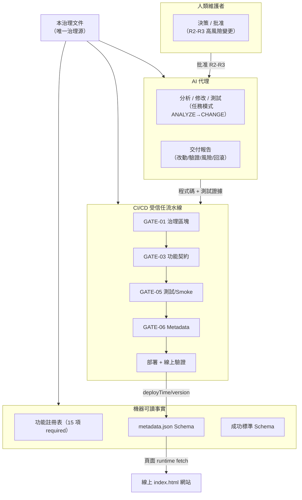
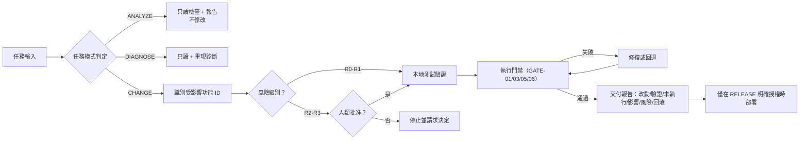
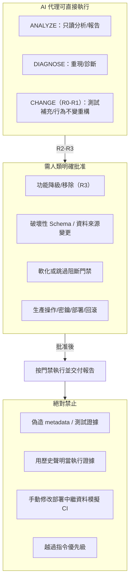
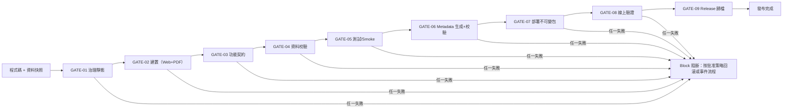

# 香港空調對比報告專案：統一治理與 AI 執行指南（繁體書面語閱讀版）

> ## 閱讀版聲明（必讀）
>
> 1. 本文件是**繁體書面語閱讀版；原治理仍為唯一機器規範來源；本版經使用者審閱，倉庫整合尚待驗收**。
> 2. 現行唯一生效之專案治理源仍為 [`docs/AIRCON_COMPARE_GOVERNANCE.md`](AIRCON_COMPARE_GOVERNANCE.md)（master 分支）。本閱讀版不具規範效力，不取代、不修改原治理文件之任何既有內容。
> 3. 本閱讀版**不得**被 AI 代理、CI/CD、發布或部署流程引用為第二個生效治理源；亦不得作為變更門禁、批准或例外之依據。本閱讀版不內嵌、不複製任何機器區塊（含 `BEGIN`／`END` 標記與 JSON）；六個規範機器區塊之唯一可編輯來源是原治理文件。如本閱讀版與原治理文件之規範正文或機器區塊有真正衝突，一律以原治理文件為準，並須向 Codex（技術驗收）；涉及批准權限的決定由人類維護者／Code Owner 處理報告，不得任意覆蓋。
> 4. 本閱讀版不變更產品版本（`models_data.py` 的 `VERSION`）、`metadata.json`、資料快照、價格快照、佇列、黑名單或任何生成物；亦不變更原治理文件之 `document.version`、Schema、Registry、成功標準或門禁。
> 5. 本閱讀版正文為繁體書面語轉述，機器區塊內部之簡體中文機器字串仍以原治理文件為準；本閱讀版不聲稱已完成全文所有字串繁體化。
> 6. 第 20、21 節為既有排程、時間與 BigGo 受控執行要求之語義精確化，不新增批准門檻、不放寬任何安全門禁，亦不要求重新批准每日 00:30 HKT 預定觸發或既有授權；使用者本次批准只涵蓋文件表述，不等於批准額外 API 呼叫、排程架構變更或機器規範變更。任何正式納入原治理仍依原治理第 15 節變更控制。
>
> **狀態定位：** 觀察事實、歷史背景、目標狀態、未知項與示例在本閱讀版中一律明確區分（見「閱讀導覽與標記約定」）。本閱讀版**不是**即時狀態面板；任何「目前已完成／已部署」之結論，均以 `docs/STATUS.md` 及實際時間戳證據為準，不得由本閱讀版推論。

> 閱讀版版次：2026-10-13 閱讀版（日期版閱讀版標識；本版未變更原機器 `document.version`，其值以原治理 `AIRCON_AI_CONTEXT_V1.document.version` 為準）
> 文件狀態：繁體書面語閱讀版；經使用者審閱；倉庫整合尚待 Root 驗收；非機器規範來源、非生效治理源
> 對應現行治理源：[`docs/AIRCON_COMPARE_GOVERNANCE.md`](AIRCON_COMPARE_GOVERNANCE.md)（master 分支；該文件記述之最後修訂為 2026-09-21）
> 證據與狀態來源：`docs/STATUS.md`（狀態索引；實際證據包括指定版本的測試、工作流與部署核對記錄）
> 整合時間（實際環境時間）：2026-10-13 HKT；來源稿為 2026-10-12 UTC 之 GPT 審閱稿，本輪只整合、不重寫審閱結論
> 適用對象：人類維護者、AI 代理、CI/CD、發布、部署、監控與回滾流程
> 內部核對來源（不隨公開倉庫發佈）：GPT 修訂稿及審閱記錄；本閱讀版 §22 只描述其引用與本機核對結果
> 合併範圍（歷史背景）：原治理源記述本輪合併 7 個附件、逐位元組去重後為 5 份唯一內容；詳見第 18 節。

> **重要：** 本閱讀版可以協助提供專案治理上下文，但不能替代對原治理文件、實際倉庫、測試、CI 與線上環境的檢查。任何沒有現場證據的實現狀態均為 `UNKNOWN`，不得猜測為「已完成」或「未實現」。

---

## 閱讀導覽與標記約定

本閱讀版採以下標記區分資訊類別，對應現行治理源第 0.1 節之六類標籤：

| 標記 | 類別 | 含義 | 處理方式 |
| --- | --- | --- | --- |
| 【規範】 | `REQUIREMENT` | 已批准的規範要求 | 必須遵守；降低要求須走變更控制 |
| 【歷史】 | `HISTORICAL_CLAIM` | 舊文件曾作出的描述 | 只能作為調查線索；未驗證前不得當作當前事實 |
| 【目標】 | `TARGET_STATE` | 期望達到的架構或流程 | 不代表已經落地；必須檢查實際倉庫 |
| 【觀察】 | `OBSERVED` | 由命令、測試或線上檢查取得、並附有時間戳與來源的證據 | 可用於當前結論，並應報告證據來源 |
| 【未知】 | `UNKNOWN` | 尚無足夠證據 | 必須檢查或如實報告未知，不得補全想像 |
| 【示例】 | `EXAMPLE` | 僅用於解釋格式或流程的示例 | 不得複製為當前版本、日期、URL、雜湊、記錄數或實現事實 |

- 本閱讀版中【規範】標記表示所轉述的現行要求；本閱讀版本身不生效，規範效力以原治理文件為準；歷史、目標、觀察、未知與示例均會就地標明。
- 舊文件中的 `✅`、核取方塊、版本示例、時間示例與流程圖，均不構成完成證據。
- 涉及「目前狀態」之陳述，必須附上日期、來源與證據等級；否則一律按 `UNKNOWN` 處理。

### 本閱讀版章節導覽

| 章節 | 主題 | 主要類別 |
| --- | --- | --- |
| 0 | AI 必讀執行契約 | 【規範】 |
| 1 | 自包含單一治理源 | 【規範】 |
| 2 | 專案術語與不可混用概念 | 【規範】 |
| 3 | AI 啟動與執行流程 | 【規範】 |
| 4 | 角色、權限與高風險邊界 | 【規範】 |
| 5 | 規範性功能註冊表 | 【規範】 |
| 6 | EMSD 資料治理 | 【規範】 |
| 7 | 規範性執行時中繼資料 | 【規範】 |
| 8 | 版本、發布資產與 Changelog | 【規範】 |
| 9 | CI/CD 與防回歸門禁 | 【規範】 |
| 10 | 規範性成功標準 | 【規範】 |
| 11 | 部署後驗證、監控與回滾 | 【規範】 |
| 12 | 歷史問題與路線圖的正確解釋 | 【歷史】／【目標】 |
| 13 | AI 工具入口 | 【規範】 |
| 14 | AI 交付報告格式 | 【規範】 |
| 15 | 變更控制與例外 | 【規範】 |
| 16 | 自包含文件的倉庫落地 | 【目標】 |
| 17 | 發布與回歸核對清單 | 【規範】 |
| 18 | 原文件資訊覆蓋、衝突裁決與去重記錄 | 【歷史】 |
| 19 | 最終 AI 決策摘要 | 【規範】 |
| 20 | 排程、時間與事件語義（既有要求精確化） | 【規範】（既有要求之轉述） |
| 21 | BigGo 受控執行模式（既有要求精確化） | 【規範】（既有要求之轉述） |
| 22 | 機器區塊指引與整合核對說明 | 【觀察】／【歷史】 |

> 關於第 20、21 節：此兩節轉述既有已批准之受控路徑、排程事實、`docs/STATUS.md` 觀察與專案層級補充指引，只作語義精確化，**不新增**任何批准門檻、不**放寬**任何安全門禁，亦**不要求**重新批准每日 00:30 HKT 預定觸發或既有授權。使用者於 2026-10-13 批准的是本閱讀版之文件表述，**不等於**批准額外 API 呼叫、排程架構變更或任何機器規範／Schema／門禁變更；任何正式納入原治理仍依原治理第 15 節變更控制。

---

## 0. AI 必讀執行契約

### 0.1 閱讀要求

收到原治理文件（及本閱讀版，如提供）的 AI 必須先完整閱讀原治理文件，再執行專案任務。凡涉及機器區塊、Registry、Schema、成功標準、門禁與變更控制，一律以原治理文件為準。不得只摘取「禁止事項」或某個 JSON 區塊後跳過其餘條件。

本文件中的資訊分為六類，定義見「閱讀導覽與標記約定」：

| 標籤 | 含義 | AI 應如何處理 |
| --- | --- | --- |
| `REQUIREMENT` | 已批准的規範要求 | 必須遵守；降低要求需走變更控制 |
| `HISTORICAL_CLAIM` | 舊文件曾作出的描述 | 只能作為調查線索；未驗證前不得當作當前事實 |
| `TARGET_STATE` | 期望達到的架構或流程 | 不代表已經落地；必須檢查實際倉庫 |
| `OBSERVED` | 本次任務中由命令、測試或線上檢查取得的證據 | 可用於當前結論，並應報告證據來源與時間戳 |
| `UNKNOWN` | 尚無足夠證據 | 必須檢查或如實報告未知，不得補全想像 |
| `EXAMPLE` | 僅用於解釋格式或流程的示例 | 不得複製為當前版本、日期、URL、雜湊、記錄數或實現事實 |

舊文件裡的 `✅`、核取方塊、版本示例、時間示例與流程圖，均不構成完成證據。

### 0.2 指令優先級

原治理文件不得覆蓋 AI 所在平台的系統、開發者、安全規則或當前使用者明確指令。AI 應按照所在工具定義的正式指令優先級執行。對於專案內部資料，採用以下原則：

1. 當前任務的明確範圍與授權；
2. 實際適用的倉庫級指令檔案；
3. 原治理文件的規範要求與內嵌機器區塊；
4. 由原治理文件生成且經驗證一致的投影檔案；
5. 舊治理文件、歷史建議、示例與未驗證聲明。

程式碼現狀可以證明「當前實現與要求不一致」，但不能自動廢除規範要求。

### 0.3 任務模式

AI 必須先判斷任務模式，不得擅自擴大權限：

| 模式 | 使用者意圖 | 允許動作 |
| --- | --- | --- |
| `ANALYZE` | 分析、解釋、評審、報告 | 只讀檢查並報告；不修改程式碼或外部狀態 |
| `DIAGNOSE` | 定位原因 | 只讀檢查、重現與診斷；除非同時要求修復，否則不實現 |
| `CHANGE` | 修復、修改、建置 | 在請求範圍內改動、測試與交付；不自動部署 |
| `RELEASE` | 明確要求發布或部署 | 通過受信任流水線執行，並完成部署後驗證 |
| `ROLLBACK` | 明確要求恢復舊版本／資料 | 先解析精確目標與影響，再按回滾流程執行 |

「使用本指南」「繼續處理」「優化一下」本身不構成生產部署、刪除功能、發布 Release、修改權限或發送外部訊息的授權。

**既有有效授權之處理（精確化）：** 若使用者已就同一任務範圍作出明確、有效且未撤銷的授權，AI 應在該範圍內持續執行，**不需要**每一步重新詢問或重複確認。只有下一步超出既有有效授權時，才須取得相應批准。任務模式改變或涉及第 4.3 節事項時，應先核對已有授權是否涵蓋；已涵蓋者無須再次確認。此原則只避免不必要之重複詢問，不放寬任何門禁，亦不推定生產權限。

### 0.4 認知防錯硬規則

AI 必須遵守：

1. 不把目標目錄樹當作實際目錄樹；
2. 不把歷史檔案名稱當作當前實現路徑；
3. 不把示例版本、日期、URL、雜湊或記錄數寫入生產；
4. 不把 P0／P1／P2 當作完成狀態；它們只表示優先級；
5. 不把功能「受保護」誤讀為功能「已實現且正常」；
6. 不把檔案存在、函式名稱存在或頁面文字存在當作行為正常；
7. 不把測試檔案存在當作測試已執行或已通過；
8. 不把 CI 綠色當作線上部署已驗證（CI 通過只涵蓋指定 commit 與該流水線範圍，見第 0.5 節）；
9. 不把雜湊一致當作來源真實性已證明（雜湊只能證明位元組一致，不能單獨證明來源真實，見第 6.2 節）；
10. 不把使用者要求修復程式碼擴展為重構整個治理體系；
11. 不在缺少倉庫或線上存取時聲稱已修復、已部署、已同步或可回滾；
12. 不用靜態舊值、佔位符或猜測結果填補未知事實。

### 0.5 證據等級

| 等級 | 證據 | 可以支持的結論 |
| --- | --- | --- |
| E0 | 舊文件聲明、註釋、核取方塊 | 僅能提出調查線索 |
| E1 | 當前倉庫靜態檢查、檔案與設定 | 可以說明程式碼／設定現狀，不能證明執行正確 |
| E2 | 本地自動化測試與資料校驗實際通過 | 可以說明受測範圍通過 |
| E3 | 受信任 CI 對指定 commit 的報告 | 可以說明該流水線及其範圍通過 |
| E4 | 指定部署環境的中繼資料與行為驗證 | 可以說明該部署在檢查時滿足相應條件 |

- 「已部署」至少需要 E4；「功能修復」至少需要相關 E2；若任務涉及生產，則還需要 E3 與 E4。
- 任何降級結論必須明確寫出證據上限。
- **兩組必須嚴格區分的概念：**
  - **雜湊一致性 vs 來源真實性：** 雜湊一致只證明兩個位元組序列相同；它不證明資料來自經批准的官方來源，也不證明內容正確。來源真實性須另以受信任的取得程序及可追溯證據評估；來源標識、批准清單與雜湊檢查僅為其中部分條件（見第 6 節）。
  - **CI 通過 vs 部署實證：** CI 通過（E3）只適用於指定 commit 與該次流水線；它不等於任何部署環境已被驗證。只有 E4 可用於「已部署」結論。

---

## 1. 自包含單一治理源

### 1.1 本文件的權威範圍

本節說明正式治理文件的權威範圍。本閱讀版僅為正文轉述，尚未生效，亦非生效治理源。原治理文件是 aircon-compare 唯一的專案治理源，並內嵌以下機器可讀規範：

- AI 基礎上下文；
- 受保護功能註冊表；
- 功能註冊表 Schema；
- 執行時 `metadata.json` Schema；
- 發布成功標準及其 Schema。

外部 `FEATURE_REGISTRY.json`、`feature-registry.schema.json`、`SUCCESS_CRITERIA.json`、`success-criteria.schema.json` 或 `metadata.schema.json` 如需存在，只能由原治理文件相應區塊生成，屬於**唯讀投影**，不得獨立編輯。

唯一例外是部署產物中的 `metadata.json`：它記錄某一次部署的執行時事實，由受信任流水線生成，並按原治理文件內嵌 Schema 校驗。

結構化清單、列舉與欄位約束只以原治理文件內嵌規範機器區塊為準；權限、流程與行為邊界以原治理規範正文為準。如果二者出現衝突，應視為文件缺陷並停止相關高風險動作，不得由 AI 選擇對自己較方便的一項。

### 1.1.1 整體治理架構圖



### 1.2 機器區塊規則

規範性機器區塊由唯一的 HTML 邊界標記包圍。提取器必須：

1. 按區塊 ID 找到恰好一個 BEGIN 與一個 END；
2. 只接受二者之間恰好一個 `json` fenced block；
3. 嚴格 JSON 解析，拒絕註釋、尾隨逗號與重複鍵；
4. 校驗區塊自身的 `blockId`；
5. 任何缺失、重複、解析失敗或投影漂移均以非零狀態退出。

AI 不得編輯生成投影來規避修改原治理文件與相應評審。

**本閱讀版之編排約定：** 本閱讀版不內嵌、不複製六個機器區塊（含 `BEGIN`／`END` 標記與 JSON）；正文只在對應章節以相對連結指向原治理文件，避免產生第二個可編輯規範源。任何機器區塊之提取、驗證、變更與評審，一律以原治理文件為準。

### 1.3 AI 基礎上下文

> **【機器區塊指引】** 本閱讀版不內嵌、不複製任何機器區塊或 `BEGIN`／`END`／JSON 內容。`AIRCON_AI_CONTEXT_V1` 之唯一可編輯來源為原治理 [§1.3 AI 基礎上下文](AIRCON_COMPARE_GOVERNANCE.md#13-ai-基础上下文)（內嵌規範機器區塊）；本閱讀版不得作為第二個生效治理源或機器規範來源。

`evidenceAtThisMerge`（原治理 §1.3 機器區塊）只描述原治理合併時沒有取得應用倉庫、CI 與線上證據；未來 AI 每次工作仍必須重新檢查實際環境，不能把該物件改成即時狀態面板。

---

## 2. 專案術語與不可混用概念

| 術語 | 唯一定義 |
| --- | --- |
| 治理文件版本 | 原治理文件自身的版本，例如 `3.1.0`；與產品版本無關 |
| Product Version（產品版本） | 按 SemVer 管理的 aircon-compare 發布版本 |
| Build（建置） | 一次流水線內唯一且不可複用的建置標識 |
| Commit（提交） | 建置輸入的完整 Git object ID |
| Deploy Time（部署時間） | 最終部署包在受信任生產作業中封包的 UTC 時間；只有成功部署的包會在線可見 |
| Deployment Completion（部署完成） | 平台記錄的部署完成事件，用於審計 `deployTime`，不由頁面猜測 |
| Dataset Date（資料日期） | 本次展示資料的官方發布／生效日期；沒有官方日期時，才按已記錄規則使用取得日期 |
| Dataset Retrieved At（資料取得時間） | 實際取得來源快照的 UTC 時間 |
| Last Deploy（上次部署） | UI 對 `metadata.json.deployTime` 的 HKT 顯示 |
| Last Update（上次更新） | UI 對 `metadata.json.datasetDate` 的顯示 |
| Priority（優先級） | P0／P1／P2 的修復或保障優先級 |
| Protection（保護狀態） | 功能是否允許被自主降級或移除；與 Priority 不同 |
| Implementation State（實現狀態） | 根據當前倉庫與執行證據得出的狀態；原治理文件建立時統一未知 |
| Release Payload Hash（發布負載雜湊） | 對不含最終 `metadata.json` 的不可變應用與資料負載計算的 SHA-256；最終歸檔包另存獨立摘要 |
| Release Asset（發布資產） | 長期保留、帶摘要、可追溯的不可變發布資產 |
| Actions Artifact（Actions 臨時產物） | CI 臨時產物；除非明確設定長期保留，否則不能等同於 Release Asset |
| ✳ 預定觸發時間（Scheduled Trigger） | GitHub Actions cron 表達式所定義的預定時間；**不是**實際啟動時間，亦不是成功完成或驗收時間（見第 20 節） |
| ✳ 實際啟動時間（Actual Run Start） | 平台記錄的實際開始執行時間；run 建立時間另列，不得當作 job 開始時間 |
| ✳ 成功完成時間（Successful Completion） | 平台記錄的 workflow／job 成功完成時間戳；不代表已通過部署後驗收 |
| ✳ 發布驗收（Release Acceptance） | 部署後 E4 層級驗證實際通過的事件；與「部署」本身是不同事件（見第 0.5、11 節） |
| ✳ 零流量預檢（Preview） | BigGo 手動診斷之預設模式：零 provider 呼叫、零協調器讀寫（見第 21 節） |
| ✳ 唯讀協調器檢查（Coordinator Check） | 對共享協調器狀態的唯讀檢查：最多 1 次 GET，零 token、零 search、零 provider（見第 21 節） |
| ✳ 有限真實供應商冒煙（Bounded Provider Smoke） | 明確授權下之有限真實 provider 測試：受上限約束的 token／search 用量（見第 21 節） |
| ✳ 正式批次（Formal Batch） | 僅可經受控 stage runner、lease／budget／cooldown／冪等與 write-ahead intent 執行之價格批次（見第 21 節） |

> ✳ 標記之列對應第 20、21 節，屬既有要求之術語精確化；不改變上表原有術語之任何語義，亦不新增門檻或批准要求。

當倉庫使用不同顯示文案時，可以保留 UI 文案，但內部語義與資料來源必須與上表一致。

---

## 3. AI 啟動與執行流程

### 3.1 啟動檢查

AI 每次接手任務必須按順序完成：

1. 識別任務模式與明確授權；若同一任務範圍已有有效且未撤銷之授權，於該範圍內沿用，不需要重複詢問，只有超出既有有效授權時才須取得相應批准（見第 0.3、4.3 節）；
2. 找到實際倉庫根目錄；如果沒有倉庫，只能處理文件或給出待驗證方案；
3. 讀取作用域內的 `AGENTS.md`、`CLAUDE.md`、Cursor／Copilot 規則等實際指令；
4. 檢視工作區狀態，保留使用者既有修改，不覆蓋無關工作；
5. 列出實際檔案樹與技術棧設定，不根據舊流程圖猜測檔案名稱；
6. 讀取原治理文件的全部規範區塊，並驗證 JSON 可解析（本閱讀版不內嵌機器區塊）；
7. 查找生成投影並與原治理文件內嵌區塊比較；不一致時報告漂移；
8. 對本次受影響功能建立「要求—當前證據—差距—測試」矩陣；
9. 評估資料、Schema、部署、權限與回滾風險；
10. 再開始範圍內的修改。

### 3.2 當前狀態判定

對每項相關要求，AI 必須使用以下狀態之一：

- `unknown`：尚未檢查；
- `present_unverified`：靜態實現可能存在，但未執行；
- `verified_pass`：相關測試或部署檢查已實際通過；
- `verified_fail`：有可重現的失敗證據；
- `not_applicable`：有明確理由不適用於當前任務；
- `blocked`：缺少權限、輸入、環境或必要決定。

不得使用「看起來正常」「應該已經」「大概支持」等模糊狀態。

### 3.3 檔案不存在時

- 目標結構中的檔案不存在，只能證明「該路徑不存在」，不能證明相應功能不存在；
- 舊文件提到的 `fetch_emsd.py`、`verify_emsd.py`、`compare_emsd.py`、`generate_html.py`、`generate_pdf.py` 是【歷史】建議路徑，不保證當前倉庫使用這些名稱；
- 不得為了匹配流程圖而擅自建立、移動或重新命名檔案；
- 只有當當前任務需要該治理元件時，才在實際技術棧中實現等價職責；
- 缺少 Registry 投影時，直接使用原治理文件內嵌 Registry，不得重新發明功能清單。

### 3.4 修改前與修改後

修改前必須：

- 指出受影響的功能 ID；
- 對 Bug 建立重現步驟或失敗測試；不能重現時說明；
- 確定最小改動範圍；
- 確定實際可執行的驗證命令，不憑空假設 `npm`、Python 或其他工具存在；
- 對高風險操作確認人類授權。

修改後必須：

- 執行與風險相稱的靜態、單元、整合、冒煙與資料檢查；
- 如實列出實際命令、退出結果與未執行項目；
- 檢查是否意外修改了受保護功能、生成檔案或使用者既有改動；
- 更新本次變更直接影響的 Changelog、測試、ADR 或規範區塊；
- 不手動修改部署中繼資料來模擬 CI；
- 提供可執行回滾方案。

推薦路徑（【目標】流程）：

```text
任務授權
  → 倉庫發現
  → 事實與要求對齊
  → 最小範圍修改
  → 自動化驗證
  → 差異與風險複核
  → 交付報告
  → 僅在明確授權時發布 / 部署
```

### 3.5 AI 治理流程圖



---

## 4. 角色、權限與高風險邊界

### 4.1 角色

| 角色 | 可執行職責 | 必須升級給人類維護者的事項 |
| --- | --- | --- |
| AI 代理 | 分析、實現已授權改動、測試、記錄證據與風險 | 功能降級、破壞性 Schema、生產權限、門禁例外 |
| 人類維護者／Code Owner | 批准規範、功能狀態、相容性與高風險變更 | 不得繞過組織安全與審計要求 |
| CI | 確定性執行校驗並保存報告 | 不得把關鍵失敗偽裝成警告或成功 |
| 發布工作流 | 生成中繼資料、封包、部署、驗證、歸檔 | 不得執行來自不受信任 PR 的生產程式碼 |
| 事故負責人 | 分級、止損、回滾、溝通與複盤 | 不得混用未經相容性驗證的應用與資料 |

### 4.2 風險級別

| 級別 | 示例 | 最低要求 |
| --- | --- | --- |
| R0 | 只讀分析、狀態報告 | 引用證據，不修改程式碼或外部狀態 |
| R1 | 文案、測試補充、行為不變的局部重構 | 相關測試、差異複核與可逆變更 |
| R2 | 使用者行為、依賴、建置或資料轉換變化 | 完整影響分析、行為測試、回滾方案與人類評審 |
| R3 | 功能降級、破壞性 Schema、生產權限、資料來源、部署或回滾架構 | 明確人類批准、ADR、相容與遷移計畫、全部適用門禁 |

風險級別描述變更的影響，不代表授權。即使是 R0，也不得超出當前任務範圍；R2–R3 不得從「優化」「整理」或「修復」等寬泛措辭推定生產權限。

### 4.3 必須明確批准的事項

下列變更必須有人類明確批准：

- 降低、棄用或移除受保護功能；
- 改變 EMSD 來源、解析、標準化、雜湊、欄位語義、排名或推薦規則；
- 對 Registry、Metadata Schema 或資料契約作破壞性變更；
- 刪除、跳過、軟化 CI 阻斷門禁；
- 操作生產、密鑰、權限、Release、部署或回滾；
- 覆蓋使用者既有且與任務無關的工作區修改；
- 修改原治理文件硬性規則或建立例外。

AI 不得把「使用者要求修 Bug」解釋為上述批准。

**與既有授權之關係（精確化）：** 上述各項若已包含在同一次明確授權內，且授權仍然有效，則 AI 可依該授權執行，不需要逐項重複詢問；但授權必須具體指向該高風險事項，且不得由「修復」「優化」「整理」等寬泛措辭推定。若查閱既有指示後，仍無法確認某項高風險動作的授權，應暫停該項動作並提出具體問題；其他已獲授權的工作可繼續。

### 4.4 AI 代理權限模型



---

## 5. 規範性功能註冊表

### 5.1 狀態解釋

本節只定義**最低保護要求**，不聲稱功能當前已經存在或正常。所有功能的實際狀態必須按第 3.2 節重新取證。

> **【機器區塊指引】** 本閱讀版不內嵌、不複製 `AIRCON_FEATURE_REGISTRY_SCHEMA_V1` 與 `AIRCON_FEATURE_REGISTRY_V1`。兩個區塊之唯一可編輯來源為原治理 [§5.1 狀態解釋](AIRCON_COMPARE_GOVERNANCE.md#51-状态解释) 內嵌之規範機器區塊；Registry 之欄位、列舉、`testBindings` 與 15 項 required 功能清單一律以該處為準。


### 5.2 Registry 使用規則

- `testBindings` 在原始治理合併時為空；原治理內嵌條目現已填寫綁定。填寫綁定只構成靜態證據，不表示測試已執行或完整滿足契約；實際結果見相應測試報告；
- AI 檢查實際倉庫後，可在經評審的治理變更中填寫穩定測試 ID；
- 在測試綁定完成前，Feature Check 必須報告缺口，不能偽造測試名稱使門禁變綠；
- 功能狀態從 `required` 降級必須有人類批准、ADR、遷移計畫、SemVer 判斷與回滾方案；
- 新功能必須先登記要求與測試契約，再進入生產；
- 原始碼關鍵字掃描只能作為 E1，不可代替行為測試。

> 【觀察】截至 `docs/STATUS.md` §31.7 之記錄，Feature Check 實跑 15 項 required／18 個 collection 節點；該數字屬該快照之 E2 證據，不是永久事實。最新結果必須重新執行並以報告為準。

---

## 6. EMSD 資料治理

### 6.1 規範資料鏈路

```text
經批准的 EMSD 官方來源
  → 保存不可變原始快照與回應證據
  → 解析、結構、欄位、單位、重複、缺失、範圍檢查
  → 標準化與確定性轉換
  → 比較、排名、推薦與報告
  → Web / PDF
  → metadata.json 記錄實際快照身份
```

具體腳本、語言與目錄必須從倉庫發現。歷史文件中的 Python 檔案名稱只代表邏輯階段（【歷史】）。

### 6.2 每個資料快照必須記錄

- 經批准的 EMSD URL 或穩定來源標識；
- 官方發布／生效日期及其日期依據；
- UTC 取得時間；
- 原始回應位元組的 SHA-256；
- 穩定快照 ID；
- 記錄數、格式／Schema 版本；
- 轉換程式碼版本或可追溯 commit；
- 原始快照，或可合法且可靠重取該快照的官方版本標識。

**【規範】雜湊與真實性的界限：** SHA-256 只能證明位元組一致，不能單獨證明來源真實。來源真實性須同時依賴「來源標識在批准清單內」、來源網域／識別碼校驗，以及快照與發布中繼資料之間的可追溯鏈。任何以「雜湊一致」推論「來源已證實」的報告均屬證據越界（對應第 0.4 節第 9 條）。

### 6.3 Dataset Check 必須驗證

- 來源網域／標識在批准清單內；
- 檔案可解析，必填欄位、型別與單位符合實際資料契約；
- 唯一鍵無意外重複，關鍵欄位無意外缺失；
- 數值範圍合理，記錄數異常變化觸發已設定的門禁；
- 雜湊按原始位元組計算且與發布中繼資料一致；
- 轉換確定、可重現且不覆蓋原始快照；
- Web、PDF 與中繼資料引用同一快照；
- 校驗失敗以非零狀態阻止資料進入發布包。

欄位、單位與異常閾值必須在倉庫的 Schema／設定與測試中定義；本閱讀版不猜測 EMSD 當前欄位格式。

---

## 7. 規範性執行時中繼資料

### 7.1 中繼資料 Schema

舊 `version.json`、`last_deploy.json` 與 `dataset.json` 是遷移輸入，不是目標並行來源。完成所有消費者遷移前不得提前刪除；遷移完成後不得繼續寫入。

> **【機器區塊指引】** 本閱讀版不內嵌、不複製 `AIRCON_METADATA_SCHEMA_V1`。`metadata.json` Schema 之唯一可編輯來源為原治理 [§7.1 元數據 Schema](AIRCON_COMPARE_GOVERNANCE.md#71-元数据-schema) 內嵌之規範機器區塊；欄位、型別、`const`／`enum`／`pattern` 與 rollback 條件一律以該處為準。

> 【歷史】2026-09-03（D12）：新增 optional `rawRecordCount`／`registrationCount`／`modelCount`（integer、minimum 0），向後相容；`recordCount` 繼續表示唯一型號／產品計數。CI 未傳入新欄位時可以省略。

### 7.2 生成、發布與讀取

1. 生產 `metadata.json` 只能在受信任部署作業中生成；
2. 輸入必須來自 tag／release version、完整 commit、workflow run 與通過校驗的資料報告；
3. `releasePayloadHash` 必須對不含最終 `metadata.json` 的不可變應用與資料負載計算 SHA-256，避免自我引用；最終歸檔包另存獨立摘要；
4. `deployTime` 在最終部署包封裝前以 UTC 生成，不接受開發者手填；它是封裝時間，**不是**平台部署完成時間，也不是 Pages 流程完成時間；
5. 生成後必須以支援 JSON Schema Draft 2020-12 且啟用 format 校驗的驗證器檢查；
6. 只有成功部署的新包會在線可見；失敗部署不得覆蓋上一次成功包；
7. 頁面、PDF 與監控只讀取該部署包的同一份中繼資料；
8. Last Deploy 將 UTC 轉換為 `Asia/Hong_Kong`，並顯示 HKT；
9. Last Update 顯示 `datasetDate`，不得顯示 `datasetRetrievedAt` 冒充官方資料日期；
10. 載入失敗時顯示「暫不可用」並上報，不得回退到硬編碼舊值；
11. 必須有快取失效策略，部署後驗證要讀取當前包而非 CDN 舊快取；
12. Metadata 生成、Schema、顯示同步或線上比對失敗均為阻斷性失敗。

### 7.3 回滾中繼資料

回滾重用已驗證的舊發布負載與相容資料快照，但透過當前受信任工作流生成新的中繼資料：

- `version` 可為被恢復的舊產品版本；
- `deployTime` 是本次回滾部署包封裝的 UTC 時間，並非回滾完成或驗收時間；
- `deploymentType` 為 `rollback`；
- `rollbackOfBuild` 指向被撤回的建置；
- `releasePayloadHash` 反映實際恢復的應用與資料負載；
- 所有 dataset 欄位反映實際回滾後快照。

不得整包重用舊 `metadata.json`，否則 Last Deploy 會錯誤顯示原始發布時間。

---

## 8. 版本、發布資產與 Changelog

### 8.1 SemVer

產品採用 `MAJOR.MINOR.PATCH`：

- MAJOR：不相容的 API、資料契約、URL、互動或部署要求；
- MINOR：向後相容的新功能；
- PATCH：向後相容的修復與內部改進。

程式碼量不是 Major 的判斷依據。顯示可加 `v`，中繼資料 `version` 不帶 `v`。產品版本不得在 Hero、Footer、README、PDF 與腳本中多點手工維護。

### 8.2 Changelog

實際倉庫的 Changelog 是變更歷史證據，必須在倉庫中檢查；本閱讀版不假設它存在或完整。若採用 `CHANGELOG.md`，應遵循一致的 Keep a Changelog 風格，開發內容進入 `Unreleased`，發布時歸檔到實際版本。

### 8.3 發布資產

每個生產發布應長期保存：

- 與線上一致的 Web 負載與 PDF；
- 使用的資料快照或穩定合法的快照引用；
- `metadata.json`；
- 測試、資料與 Schema 校驗報告；
- 發布負載與資料快照的獨立 SHA-256；
- tag、完整 commit、workflow run、審批與 Deployment 記錄。

預設會過期的臨時 CI Artifact 不能單獨證明可回滾。應使用 GitHub Release assets 或具有明確保留、存取與完整性策略的不可變儲存。

> 【歷史】`docs/STATUS.md` 曾記錄 Actions Artifact 保留與 Release 歸檔的演進（含 GATE-09 手動歸檔、CHECKSUMS 與 PROVENANCE）；該等記錄屬歷史快照，最新資產狀態必須以實際 Release／歸檔回讀為準。

---

## 9. CI/CD 與防回歸門禁

### 9.1 抽象階段

| Gate ID | 階段 | 必須檢查 | 失敗處理 |
| --- | --- | --- | --- |
| GATE-01 | Governance / Static | 規範區塊可提取、JSON 與 Schema 有效、投影無漂移、語法與依賴策略 | Block |
| GATE-02 | Build | 以倉庫聲明命令可重複生成 Web 與 PDF | Block |
| GATE-03 | Feature Contract | required 功能有有效測試綁定，測試真實執行 | Block |
| GATE-04 | Dataset | 來源、結構、日期依據、記錄數、快照與原始雜湊有效 | Block |
| GATE-05 | Test / Smoke | 單元、整合、瀏覽器核心路徑、響應式與 PDF | Block |
| GATE-06 | Metadata / Package | 受信任環境生成並校驗唯一中繼資料，封裝指定部署包 | Block |
| GATE-07 | Deploy | 受保護環境部署確切的不可變包 | Block |
| GATE-08 | Post-deploy | 線上可達、中繼資料匹配、核心行為與顯示值正確 | Block；按批准策略回滾或進入事件流程 |
| GATE-09 | Release Archive | 資產、雜湊、報告、tag 與 Changelog 可追溯 | 不得標記發布完成 |

不存在「關鍵 Metadata 失敗但僅警告」的合規路徑。

> 【規範】上表為抽象階段定義。實際倉庫中一個 Gate 可以由多個 job 承擔，或多個 Gate 合併於同一 workflow；實際映射必須從 workflow 與腳本發現，並以實際 run 證據為準，不得由本表推測現行實作。

### 9.1.1 DevOps 治理流水線圖



### 9.2 Feature Check

Feature Check 必須：

1. 提取並按 Schema 校驗 Registry；
2. 檢查 ID 唯一、Protection 合法；
3. 解析實際測試清單；
4. 證明每個 required 功能綁定到存在且非空的測試；
5. 實際執行相關測試並輸出 JUnit、JSON 或等價機器報告；
6. 把 skip、only、空斷言、吞異常與總是成功視為失敗或經批准例外；
7. 以瀏覽器測試覆蓋使用者可見 P0 路徑；
8. 只把程式碼掃描作為輔助 E1 證據；
9. 任一缺失、漂移或失敗返回非零狀態。

### 9.3 PR 與生產邊界

- PR 可執行靜態、建置、Feature、Dataset 與測試門禁，但使用明確標記的測試中繼資料；
- 只有受保護分支／tag 的受信任工作流可以生成生產中繼資料並存取生產環境；
- fork 或不受信任 PR 的程式碼不得在生產權限上下文中執行；
- 權限最小化，第三方 Actions 固定到已審查的完整 commit；
- 生產 Environment 使用併發控制與專案要求的人工審批；
- AI 不得臆造命令名稱；應從 `package.json`、鎖定檔、Makefile、任務設定與現有 Workflow 發現實際命令。

---

## 10. 規範性成功標準

原治理文件 §10 機器區塊之 `baselineEvidenceState` 是文件合併時的狀態，不是每次發布的即時結論。實際通過狀態必須來自相應執行證據；本閱讀版不複製該區塊。

> **【機器區塊指引】** 本閱讀版不內嵌、不複製 `AIRCON_SUCCESS_CRITERIA_SCHEMA_V1` 與 `AIRCON_SUCCESS_CRITERIA_V1`。兩個區塊之唯一可編輯來源為原治理 [§10 規範性成功標準](AIRCON_COMPARE_GOVERNANCE.md#10-规范性成功标准) 內嵌之規範機器區塊；SC-001..016 之 `blocking`、`gateScope`、`passCondition` 與 `requiredEvidence` 一律以該處為準。


未建立自動證據前，可以記錄治理缺口，但不得把人工推測填成通過。人工證據必須包含負責人、時間、範圍、結果與可存取連結。

---

## 11. 部署後驗證、監控與回滾

### 11.1 部署後驗證

發布只有在以下檢查完成後才算成功：

- 首頁、核心靜態資源、`metadata.json` 與 PDF 可存取；
- 線上 version、build、commit、workflowRunId、releasePayloadHash 與本次核准部署產物的預期 metadata 完全一致；產物建置 run、部署 run 及 merge commit 分別記錄，不要求其識別碼相同；
- Version、Last Deploy、Last Update 的 UI 值來自同一線上中繼資料；
- Registry 中 P0／required 的瀏覽器路徑通過；
- Web 與 PDF 的資料快照身份一致；
- 快取沒有返回舊中繼資料；
- 任何檢查失敗時，不得標記發布成功；須按已批准策略發出告警並進入回滾或事件處理流程。

### 11.2 最低監控

| 監控域 | 最低檢查 |
| --- | --- |
| 可用性 | 首頁、關鍵資源、中繼資料、PDF |
| 部署一致性 | 線上 version／build／commit／workflow run／releasePayloadHash |
| 功能 | required 核心使用者路徑定期冒煙 |
| 資料 | 來源、日期依據、記錄數、雜湊、Schema 與顯示同步 |
| 新鮮度 | Dataset Date 超過專案設定閾值 |
| 回滾資產 | 最近已知良好資產仍可取得且摘要有效 |

頻率、閾值、接收者與靜默規則屬於實際監控設定，AI 必須檢查而非猜測。

### 11.3 回滾級別

| 級別 | 範圍 | 受控做法 |
| --- | --- | --- |
| L1 | 小範圍程式碼／UI 缺陷 | Revert 或 Hotfix，發布新 Patch，完整走 CI |
| L2 | 應用發布故障 | 選擇已知良好不可變負載，生成新回滾中繼資料後部署 |
| L3 | 資料快照故障 | 校驗相容性後恢復已驗證舊快照 |
| L4 | 應用與資料／全站故障 | 恢復經過驗證的相容應用、資料與設定組合 |

可變分支不是回滾依據。目標必須由 tag、commit、發布摘要與資料快照 ID 唯一確定。

### 11.4 回滾步驟

1. 明確事故、負責人、影響與發布凍結範圍；
2. 選擇最近已知良好且證據完整的目標；
3. 校驗資產雜湊、Schema 與應用—資料相容性；
4. 透過受信任工作流生成新回滾中繼資料；
5. 部署並執行與正常發布相同的線上驗證；
6. 監控恢復並記錄實際結果；
7. 更新事件記錄、Changelog／Issue，完成根因與防復發措施。

沒有可取得資產、資料快照與成功演練時，不得宣稱 L2–L4 可執行。

---

## 12. 歷史問題與路線圖的正確解釋

### 12.1 歷史問題

原治理 §1.3 機器區塊中的五個 `historicalClaims`（本閱讀版不複製機器區塊）均為調查入口，不是當前 Issue 狀態。AI 必須：

1. 在實際倉庫、CI、Release 與線上環境分別取證；
2. 將結果標記為 `verified_pass`、`verified_fail`、`blocked` 或 `unknown`；
3. 提供具體檔案、測試、run 或 URL 證據；
4. 只有當前任務授權修復時才實施修復；
5. 將持續狀態放入 Issue Tracker，不在原治理文件複製即時狀態。

> 【歷史】五個調查入口為：`HIST-P0-LAST-DEPLOY`（Last Deploy 曾在 v1.2.6 存在，後續維護中被移除）、`HIST-P0-LAST-UPDATE`（資料更新後頁面 Last Update 仍使用靜態日期）、`HIST-P1-METADATA`（統一版本／建置／部署與資料中繼資料鏈尚未建立）、`HIST-P1-ARTIFACT`（缺少可長期取得的發布資產，因此回滾未被證明可執行）、`HIST-P2-DATASET-TRACKING`（資料快照追蹤與原始雜湊校驗不完整）。以上均屬 `truthStatus: historical_claim_unverified`。

### 12.2 舊路線圖

【歷史】舊文件曾建議：

- Phase 1：Last Deploy、Version Metadata、Smoke Test；
- Phase 2：Release Automation、Artifact Archive、Dataset Hash；
- Phase 3：Monitoring、Alert、Auto Issue；
- Phase 4：AI Assisted Maintenance、AI Governance、Self-healing Pipeline。

【規範】上述內容屬 `HISTORICAL_CLAIM / TARGET_STATE`，不是已批准的當前工作隊列，也不代表已完成。尤其 Auto Issue、告警發送、自癒與自動回滾會改變外部狀態，必須有明確授權、權限邊界、速率限制、冪等與人工接管方案。

> 【觀察】`docs/STATUS.md` 後續章節記錄了其中部分項目（例如新鮮度監控、歸檔工具、受控 BigGo 階段）之演進；該等記錄屬特定日期之 E2／E3／E4 快照，最新狀態必須重新回讀，不得由本節推論。

---

## 13. AI 工具入口

`AGENTS.md` 不是所有工具的通用入口。應按實際工具版本建立薄入口：

| 工具 | 常見專案入口 |
| --- | --- |
| 支援 AGENTS.md 的 Agent | `AGENTS.md` |
| Claude Code | `CLAUDE.md` |
| Cursor | `.cursor/rules/governance.mdc`；舊版本才使用 `.cursorrules` |
| GitHub Copilot | `.github/copilot-instructions.md` |
| 其他 | 使用該工具當前正式機制並驗證確實載入 |

入口只應引導讀取原治理文件，不複製全部規則。最小語義如下：

```text
修改前完整讀取 docs/AIRCON_COMPARE_GOVERNANCE.md。
先識別任務模式、檢查實際倉庫並區分 requirement / historical claim / target / observed / unknown。
不得自主降低 required 功能，不得偽造中繼資料與測試證據，不得繞過阻斷門禁。
完成後報告改動、證據、測試、未知項、風險與回滾。
規則衝突或缺少高風險授權時停止相關動作並請求決定。
```

如果多個工具需要重複入口文本，應從一個模板生成並由漂移檢查驗證。入口機制隨工具版本變化，必須現場確認。

---

## 14. AI 交付報告格式

每次完成任務，AI 的最終報告必須包含適用項目：

1. **結果：** 完成了什麼；是否達到請求目標；
2. **事實依據：** 使用了哪些 E1–E4 證據；
3. **改動檔案：** 精確路徑與用途；
4. **驗證：** 實際執行命令、測試數、結果與退出狀態；
5. **未驗證／未執行：** 原因及其影響；
6. **功能影響：** 相關 Registry ID，是否有行為或相容性變化；
7. **資料影響：** 快照、日期、雜湊或轉換是否變化；
8. **發布狀態：** 未部署、已部署或部署受阻；不得省略環境；
9. **風險與回滾：** 剩餘風險及可執行恢復方式；
10. **需要人類決定：** 僅列真正阻斷或需額外授權的事項。

不得只輸出「已優化」「測試通過」「應該沒問題」等無證據總結。

---

## 15. 變更控制與例外

### 15.1 治理變更

修改原治理文件或任一規範機器區塊必須：

- 通過 PR 與 Code Owner 審批；
- 解釋動機、相容性、遷移與風險；
- 同步提取器、生成投影與測試；
- 更新治理文件版本與實際 Changelog；
- 驗證所有機器區塊與內部引用；
- 不得在同一提交中悄悄降低門禁。

### 15.2 ADR

功能移除、破壞性 Schema、資料來源更換、部署架構更換、權限變化與回滾策略變化必須建立 ADR，記錄背景、決定、替代方案、後果、批准人與日期。

### 15.3 臨時例外

每個例外必須包含唯一 ID、範圍、理由、風險、補償控制、驗證方法、人類批准人、生效／到期時間、恢復負責人與 Issue。到期必須自動失效。

AI 不能批准涉及 P0 功能、資料真實性、憑證安全、生產權限或部署證據的例外。

---

## 16. 自包含文件的倉庫落地

### 16.1 推薦目標結構

下列是【目標】狀態，不是對當前倉庫的描述：

```text
aircon-compare/
├── docs/
│   ├── AIRCON_COMPARE_GOVERNANCE.md       # 唯一可編輯治理源
│   ├── CHANGELOG.md                       # 實際變更歷史
│   ├── generated/
│   │   ├── FEATURE_REGISTRY.json          # 從原治理文件提取
│   │   ├── feature-registry.schema.json   # 從原治理文件提取
│   │   ├── SUCCESS_CRITERIA.json          # 從原治理文件提取
│   │   ├── success-criteria.schema.json   # 從原治理文件提取
│   │   └── metadata.schema.json           # 從原治理文件提取
│   └── adr/
├── scripts/
│   ├── extract-governance.*               # 提取並驗證唯一機器區塊
│   ├── feature-check.*
│   ├── dataset-check.*
│   ├── gen-metadata.*
│   └── validate-metadata.*
├── tests/
│   └── smoke/
├── AGENTS.md                              # 如實際工具支援
├── CLAUDE.md                              # 如實際使用 Claude Code
├── .cursor/rules/governance.mdc           # 如實際使用 Cursor
├── .github/
│   ├── copilot-instructions.md
│   └── workflows/
└── DEPLOYMENT_ARTIFACT_ROOT/              # 邏輯名稱；從實際建置設定解析
    ├── index.html
    ├── report.pdf                         # 受保護輸出；變更需走功能狀態控制
    └── metadata.json                      # 部署執行時事實
```

腳本副檔名、建置目錄與 Workflow 檔案名稱由實際技術棧決定。

### 16.2 首次落地步驟（原始檢查清單，非當前進度）

【歷史】以下清單為文件建立時之首次落地建議，不代表任何項目已完成或未完成：

- [ ] 把原治理文件放到倉庫並由 Code Owner 批准為治理源；
- [ ] 實現確定性區塊提取與 JSON／Schema 校驗；
- [ ] 將任何現有外部 Registry、Schema、成功標準與原治理文件逐項對齊，不盲目覆蓋；
- [ ] 為 Registry 的 required 功能綁定實際測試 ID；
- [ ] 追蹤並遷移舊三個中繼資料檔案的所有消費者；
- [ ] 修復經取證確認的 P0；
- [ ] 建立 CI 阻斷門禁與部署後檢查；
- [ ] 保存長期 Release assets 並完成應用、資料回滾演練；
- [ ] 建立實際 AI 工具入口與漂移檢查；
- [ ] 歸檔舊治理文件，避免它們繼續被 AI 當作並行指令。

---

## 17. 發布與回歸核對清單

### 發布前

- [ ] 已確認任務／發布授權與目標環境；
- [ ] 規範機器區塊可提取、可解析並通過 Schema；
- [ ] 生成投影與原治理文件一致；
- [ ] required 功能測試綁定完整且實際通過；
- [ ] EMSD 來源、日期依據、快照、記錄數與原始雜湊通過；
- [ ] Web、響應式介面與 PDF 建置／冒煙通過；
- [ ] SemVer、Changelog、相容性與回滾目標已評審；
- [ ] 沒有未批准 skip 或軟化門禁。

### 部署時

- [ ] 由受信任作業生成唯一 `metadata.json`；
- [ ] Metadata Schema 與 format 校驗通過；
- [ ] 精確部署包、資料快照與摘要已確定；
- [ ] 生產權限、Environment、審批與併發控制正確；
- [ ] 長期發布資產與證據保存成功。

### 部署後

- [ ] 線上 version、build、commit、workflow run、releasePayloadHash 與預期一致；
- [ ] Last Deploy 與 Last Update 的來源、顯示與時區正確；
- [ ] P0／required 核心使用者路徑通過；
- [ ] Web、PDF 與資料快照一致；
- [ ] 快取未返回舊中繼資料；
- [ ] 監控無新增嚴重告警；
- [ ] 回滾目標仍可取得且摘要有效。

---

## 18. 原文件資訊覆蓋、衝突裁決與去重記錄

> 本節全屬【歷史】，保存原治理源之合併記錄，供追溯之用；不作為當前狀態或待辦清單。

### 18.1 去重結論

逐位元組比較確認：本輪共收到 7 個附件，實際為 5 份唯一內容；兩組重複副本只計一次。規範性 SHA-256 與副本數只保存在 `AIRCON_AI_CONTEXT_V1.sourceLineage`，避免在同一文件內維護第二份可漂移雜湊表。

| 本輪物理檔案 | 去重與角色 |
| --- | --- |
| `input-01`、`input-06` | 位元組相同；原《Enterprise AI Governance Framework》 |
| `input-02`、`input-07` | 位元組相同；原《AI Maintenance Guide / 優化建議和圖表》 |
| `input-05` | v2.0.0 合併重構稿 |
| `input-03` | v3.0.0 候選 A：證據等級、自包含上下文與規範區塊較完整 |
| `input-04` | v3.0.0 候選 B：風險分級、衝突裁決與發布負載摘要較明確 |

本 v3.1.0 吸收五份唯一內容；重複附件不重複形成要求，兩份 v3 候選也不互相覆蓋，而是按保守、可驗證與單一事實源原則統一。

### 18.2 內容覆蓋矩陣

| 原內容 | 本版位置 | 處理方式 |
| --- | --- | --- |
| 願景、AI 使命與禁止事項 | 第 0、3、4 節 | 改為任務模式、證據等級、風險分級與可執行硬規則 |
| 核心／系統／受保護功能 | 第 5 節 Registry | 取原始資料並集，明確「要求不等於實現狀態」 |
| 系統架構與資料流 | 第 6、16 節 | 保留邏輯階段，移除對未驗證腳本路徑的假設 |
| 三份舊中繼資料建議 | 第 7 節 | 遷移為單一執行時中繼資料，並提供完整 Schema |
| Version Flow 與 Hero 顯示 | 第 2、7、8 節 | 統一術語、UTC 儲存、HKT 顯示，不保留示例當前值 |
| CI/CD 與 Feature Check | 第 9 節 | 從關鍵字掃描提升到 Registry—測試—行為證據 |
| Smoke Test／Success Criteria | 第 5、10、17 節 | 形成機器標準並明確證據範圍 |
| Release、Artifact 與 Rollback | 第 7、8、11 節 | 使用負載摘要、不可變資產與新回滾中繼資料 |
| Monitoring | 第 11 節 | 明確最低監控與未知閾值處理 |
| 已知問題、Maintenance Tasks | 第 1、12、16 節 | 全部標記歷史聲明，要求現場驗證 |
| Roadmap／Self-healing | 第 12 節 | 保留為非授權歷史建議，限制外部副作用 |
| AI 檢查提示詞 | 第 0、3、14 節 | 改為穩定執行與報告協議 |
| 多 AI 自動載入 | 第 13 節 | 按工具入口區分，不誤稱 `AGENTS.md` 通用 |
| 圖示標準 | 第 18.4 節 | 保留為非規範性視覺偏好 |
| v2.0 單一事實源改進 | 第 1、5、7、10 節 | 進一步改為單 Markdown 內嵌機器區塊，避免交接缺檔案 |
| 兩份 v3 候選 | 全文，重點為第 0、1、4、7、18 節 | 合併證據模型、自包含血緣、風險級別、負載摘要與衝突表 |

### 18.3 衝突與歧義的統一裁決

| 原資料衝突／歧義 | 本版唯一解釋 |
| --- | --- |
| 7 個附件看似 7 份獨立要求 | 實際為 5 份唯一內容；兩組位元組相同副本只計一次 |
| 功能清單與 Protected 清單範圍不同 | 採用原始功能並集，15 項先作為 `required` 要求；實現狀態仍須現場驗證 |
| 功能前出現 `✅` 或已勾選清單 | 只表示歷史文件列出該項，不構成存在、正常或測試通過證據 |
| Registry、Schema、Success Criteria 分散在外部檔案 | 本 Markdown 內嵌規範區塊是唯一可編輯來源；外部 JSON 只能生成 |
| `version.json`、`last_deploy.json`、`dataset.json` 並行 | 目標只使用一個執行時 `metadata.json`；消費者遷移完成前不得提前刪除舊檔案 |
| Build 示例同時使用數字與字串 | Schema 統一為非空受限字串，遷移前檢查真實消費者 |
| Deploy Time 使用 HKT 文字或 ISO 時間 | 儲存 UTC RFC 3339 `Z`；UI 轉換並明確顯示 HKT |
| Dataset Date 含義不清 | 必須同時記錄 `datasetDateBasis`，區分官方發布日期、生效日期與取得日期回退 |
| Metadata 失敗可降為 warning | 統一為阻斷性失敗 |
| Feature Check 只掃描程式碼文字 | 掃描只算 E1 線索；有效行為測試與實際執行結果才可證明通過 |
| 回滾依賴「切舊分支」 | 使用不可變負載、獨立摘要、tag／commit 與相容資料快照 |
| 所有 AI 自動讀取 `AGENTS.md` | 不成立；按工具正式機制建立薄入口並驗證確實載入 |
| 「有明確需求即可刪除功能」 | 必須明確授權具體 Feature 狀態變化，並走 R3 變更控制 |
| Python 檔案名稱與 Node／npm 流程同時出現 | 都是歷史或目標線索；先檢查當前技術棧 |
| v1.2.6 後欄位遺失 | 僅為未驗證歷史報告，必須在當前倉庫或線上重現 |
| 文件日期、版本、URL、雜湊、記錄數示例 | 一律為 `EXAMPLE`，絕不轉寫為產品或部署事實 |
| 兩份 v3 的 Metadata Schema 欄位不同 | 採用保守並集：保留快照 ID、回滾關聯與 hotfix，並增加非自我引用 `releasePayloadHash` |

### 18.4 非規範性圖示偏好

舊文件包含以下 UI／文件圖示建議。它們不屬於驗收標準，不得被 AI 當作必須加入頁面的功能：

| 模組 | 建議圖示 | 模組 | 建議圖示 |
| --- | ---: | --- | ---: |
| EMSD | 🏛️ | Download | 📥 |
| Verify | ✅ | Compare | ⚖️ |
| Search | 🔍 | Filter | 🎯 |
| Ranking | 🏆 | Analysis | 📊 |
| HTML | 🌐 | PDF | 📄 |
| Deploy | 🚀 | Action | ⚙️ |
| Version | 🏷️ | Build | 🔨 |
| Last Deploy | 🕒 | Changelog | 📝 |
| Smoke Test | 🧪 | Monitoring | 📡 |
| Release | 📦 | AI | 🤖 |

### 18.5 合併版本記錄

【歷史】以下版本記錄保留原治理源之記述；其中提及之任何版本、日期、雜湊與狀態均為當時快照，不得當作現行事實。

#### v3.1.0 — 2026-08-26

- 合併本輪 7 個附件的 5 份唯一內容，並修正來源副本計數；
- 統一兩份 v3 候選的證據、任務模式、風險與停止條件；
- 保留 15 項功能的保守並集及內嵌 Registry／Schema；
- 在 Metadata Schema 中加入非自我引用 `releasePayloadHash`，同時保留資料快照 ID、hotfix 與回滾關聯；
- 增加附件覆蓋矩陣與逐項衝突裁決；
- 所有應用、CI、線上與 EMSD 當前狀態仍保持 `UNKNOWN`，不得由文件合併推斷。

#### v3.0.0 候選稿 — 2026-08-26

- 將 v2 的外部事實源方案改為單 Markdown 內嵌機器區塊；
- 分別強化證據等級、自包含上下文、風險分級與歷史建議邊界。

#### v2.0.0 — 2026-08-26

- 首次將兩份原始治理資料去重合併；
- 提出統一 Metadata、行為門禁與不可變回滾資產。

#### v3.1.0 後追加（2026-08-26，非合併內容）

- 新增 4 個 Mermaid 圖：整體治理架構圖（§1.1.1）、AI Governance 流程圖（§3.5）、AI Agent 權限模型（§4.4）、DevOps Governance 流水線圖（§9.1.1）；
- 3 個歷史 ASCII 圖保留不變（§3.4 任務授權路徑、§6.1 EMSD 資料鏈路、§16.1 目標結構）。

#### v3.1.2 — 2026-09-21（文件校正，待評審）

- 校正最後修訂日期、測試綁定說明及首次落地清單的歷史語義；新增狀態核查入口。
- 六個規範區塊僅更新本治理文件版本；當時功能要求、保護狀態、Metadata Schema 與成功標準保持不變（2026-09-22 只新增 `testBindings`，未降級，見下）。
- 本次為工作區候選修改，發布與治理變更評審仍按第 15 節執行。
- 2026-09-21 後追加：v1.2.9 產品修復候選按既有 §7.2（metadata 事實來自部署作業）、§9.2（功能契約需實際行為證據）、§11.1（部署後驗證）與 §8.3（長期發布資產）落地收據雜湊綁定、完整 Draft 2020-12 驗證、pytest collection／執行證據及部署後核對／歸檔工具；**規範正文、Registry、Schema 與門禁均無放寬**。該等實現屬本機候選（E2），受信任 CI、部署後驗證與治理評審仍未完成。
- 2026-09-21 返修補充（同一候選，非規範變更）：GATE-08 修正為接受 Pages 內建 `dynamic` 事件（仍在成功／master／同 repo 條件下）；GATE-09 修正 reports 來源、`archiveCommit`／`sourceCommit`／`deploymentCommit` 事實分離、目錄＋zip 雙重 no-clobber 與嚴格 SemVer tag；官方批次改為任一目標失敗即阻斷且不以部分結果覆寫快照；EMSD CSV／sidecar 改為交易式提交；feature-check 拒絕常量斷言／吞異常總是成功；全部 workflow 第三方 Actions 固定 §9.3 要求的完整 commit。
- 2026-09-22 追加（同屬待評審治理候選）：為 `ui.comparison-modal`、`ui.responsive`、`operations.version-display`／`last-deploy`／`dataset-update`／`build-metadata`、`data.emsd-verification`、`report.pdf-export` **新增 testBindings**，令每個 required 至少有一個資料／行為節點而不只結構或文字檢查；`protection`、Schema、門禁與成功標準無變（只加綁定，未降級）。

#### v3.1.3 candidate — 2026-09-22（非規範變更記錄，待評審）

- D1-B：官方 enrichment queue 純 coverage 不足可保留 pending（queue stage／models 原樣），
  EMSD 發布繼續；public status／UI 顯示「官方規格待核」；硬失敗門禁全部保留。ADR-002 已由
  人類批准。
- D2-A：GitHub Pages 改用受信任 Actions workflow（PR 不 deploy；master deploy `needs`
  build；`environment: github-pages`；artifact 只含 `deploy_payload.json` 公開檔；第三方
  Actions 固定完整 commit）；`postdeploy-verify` 綁 exact deployment SHA。
- D4-A：新增全 reachable Git history credential audit（credential findings 必須 0；
  self-host path 列 residual risk；報告不寫 secret 原文）。
- D7-A：保存原始 EMSD response bytes 於私人 sink，公開只留 hash receipt；private save
  失敗阻斷發布；raw bytes 不入公開 worktree／artifact；90 日 retention。ADR-001 已由人類批准。
- D8-A：`age > 72h` 新鮮度 monitor、6 小時排程、issue 去重／恢復關閉。
- D3 在 2026-09-22 快照中仍待使用者選定；其後於 2026-09-23 採用 D3-A，
  GitHub API 回讀 `release` environment 唯一 reviewer 為 `CalvinLau1012`、
  `prevent_self_review=false`（見 D19）；D6 self-host 同步 deferred；E3／E4 仍 UNKNOWN。
- 本節只記錄非規範版本歷史；六個規範區塊、Registry、Metadata Schema、成功標準及 fail-closed
  門禁未修改、未降級。治理評審與 merge 批准仍待完成。

#### v3.1.1 — 2026-09-03

- Metadata Schema 新增 optional `rawRecordCount`／`registrationCount`／`modelCount`（D12：EMSD 重複登記保留全部 registration + canonical product view）；向後相容，schemaVersion 維持 1.0.0。

---

## 19. 最終 AI 決策摘要

當 AI 只拿到原治理文件時（本閱讀版僅供輔助閱讀，不替代機器區塊）：

1. 它已經擁有完整治理要求、功能保護基線、Metadata Schema、成功標準與歷史來源；
2. 它**仍不知道**程式碼、測試、CI、線上版本與歷史問題的當前狀態；
3. 它必須先檢查實際倉庫，把每項相關內容標為 `unknown`、`present_unverified`、`verified_pass`、`verified_fail`、`not_applicable` 或 `blocked`；
4. 它只能在當前使用者授權範圍內行動；已有效之授權於範圍內沿用，不需要逐步重複確認；
5. 它不得用歷史聲明、目標圖、示例或檔案存在性替代執行證據；
6. 它必須以明確的改動、驗證、未知項、風險與回滾報告結束任務。

**完成定義：** AI 不依賴猜測理解專案；功能要求不會在文件合併中丟失；資料、版本與部署時間具有唯一語義；所有「已完成」結論都能回到實際證據。

---

## 20. 排程、時間與事件語義（既有要求精確化）

> 【規範】本節轉述既有已確認之排程設定、`docs/STATUS.md` §31 之觀察記錄與專案層級補充指引，只作語義精確化。本節**不新增**任何批准門檻、不**放寬**任何安全門禁，亦**不要求**重新批准每日 00:30 HKT 預定觸發或既有授權。使用者於 2026-10-13 批准的是本閱讀版之文件表述，不等於批准額外 API、排程架構變更或機器規範變更；任何正式納入原治理仍依原治理第 15 節變更控制。

### 20.1 香港時間與 UTC 的精確對應

- GitHub Actions 排程以 `30 16 * * *`（UTC）設定，對應香港時間（HKT，UTC+8）每日 00:30。私人部署使用其自身排程器及時區設定，不能直接套用 GitHub 的 UTC 表達式。
- **00:30 HKT 等於前一個 UTC 日期的 16:30 UTC。** 例如 2026-10-13 00:30 HKT 對應 2026-10-12 16:30 UTC。任何同時書寫兩個時區的文件，必須明確標註日期是否屬於同一日，避免把「前一日 UTC」誤讀為「當日 UTC」。
- 使用者可見時間一律以 HKT 表述；系統儲存與審計時間一律以 UTC 表述（對應第 2 節 Deploy Time／Dataset Retrieved At 之定義）。

### 20.2 必須分別記錄的時間點

排程鏈路上的下列事件是**不同事件**，不得合併、不得互相代替、不得以其中一個的時間推論另一個：

| 時間點 | 定義 | 證據來源 |
| --- | --- | --- |
| 預定觸發 | 排程設定所定的應觸發時間 | cron、時區及對應日期 |
| 執行記錄建立 | 平台建立該次 run 的時間 | run 的 `created_at` |
| 實際開始 | run 或個別 job 開始執行的時間 | 對應的開始時間欄位；須註明層級 |
| 成功完成 | 指定 run／job 成功結束的時間 | 結論及可確認的完成時間；不得直接將一般 `updated_at` 當作完成時間 |
| 平台部署完成 | 平台完成部署的事件 | Deployment 記錄 |
| 發布驗收 | 指定環境的部署後檢查通過 | GATE-08 報告及線上行為證據 |

- 開始執行、工作流成功及平台部署完成，均不能單獨代替部署後驗收。
- `deployTime` 記錄部署包封裝時間，並非上述部署完成或驗收時間；重用已驗證產物時不得改寫它以迎合較新的部署 run。
- 缺少時間欄位時應明確記錄未知；不得用 run 建立或最後更新時間代填。

### 20.3 延遲與遺漏：以時間戳證據為準

- GitHub 官方文件明示：`schedule` 事件在高負載時可能延遲，甚至可能被丟棄。因此 00:30 HKT 是**預定觸發**設定，**不是**準時開始的保證，也不是成功完成的保證。
- 【歷史】專案文件曾記錄「未有延遲量測」。該記述描述的是過往某一時點之證據狀態（`UNKNOWN`），**不得**被當作永久規則、禁止量測的規範、或「不需要證據」的藉口。
- 【規範】現況陳述要求：任何關於排程延遲、準時性或完成時間的結論，均須以附時間戳的證據支持（run ID、event 類型、建立／開始／完成時間、結論），並明確指出所屬事件類別（第 20.2 節）。沒有時間戳證據者，一律標示 `UNKNOWN`。
- 【規範】不得因為觀察到排程延遲而自動補跑、重複查價或修改 cron。任何補跑或重試必須有明確授權與冪等設計。

### 20.4 GitHub 與私人部署的排程關係

- GitHub Actions 排程與私人部署排程是**各自獨立**的排程；沒有主從、沒有先後保證。
- 共用協調器（coordinator）只協調 **BigGo 階段**，不是整體主動／備援機制，也不保證任何一方先執行。
- 公開文件只以泛稱描述私人部署；**不得**寫入私人主機名稱、網域、路徑、私人 repo 標識、token 標籤或期限。
- 【歷史更正，按只追加政策保留原文】過往文件曾記述「私人 server 工作仍暫停」；該記述已被後續觀察取代（私人部署恢復、獨立排程運行中）。歷史原文保留，現況以最新時間戳證據為準。

---

## 21. BigGo 受控執行模式（既有要求精確化）

> 【規範】本節轉述既有受控執行路徑與診斷模式，來源包括已批准的 BigGo 架構決策、`docs/STATUS.md` §31.4 之代碼核對記錄及專案層級補充指引。本節只作語義精確化，**不新增**批准門檻、不**放寬**安全門禁，亦**不要求**重新批准任何既有授權。使用者於 2026-10-13 批准的是本閱讀版之文件表述，不等於批准額外 API 呼叫、排程架構變更或機器規範變更；任何正式納入原治理仍依原治理第 15 節變更控制。

### 21.1 四種模式必須分別定義

| 模式 | 目的 | provider 流量 | 協調器操作 | 授權要求 |
| --- | --- | --- | --- | --- |
| A. 零流量預檢（Preview） | 檢查本機狀態、計畫與候選，不接觸網絡或共享狀態 | 零 | 零讀寫 | 無須額外授權；為手動診斷之預設模式 |
| B. 唯讀協調器檢查（Coordinator Check） | 確認共享協調器狀態可讀、設定可解析 | 零（不呼叫 provider） | 最多 1 次 GET，零寫入 | 無須額外 provider 授權 |
| C. 有限真實供應商冒煙（Bounded Provider Smoke） | 以最小用量確認 provider 連通性 | 最多 1 次取得存取憑證請求及 1 次搜尋請求 | 依受控路徑之規定 | 需要明確授權之受控執行 |
| D. 正式批次（Formal Batch） | 執行價格批次更新 | 依 stage 預算與上限 | lease／budget／cooldown／冪等／write-ahead intent | 僅限受控 runner 與已批准之 stage |

四種模式的語義**不可互換**。特別是：`--check-coordinator`（模式 B）與 `--execute`（模式 C）在使用者介面上互斥；以模式 B 的成功推論 provider 健康、或以模式 A 的成功推論任何網絡事實，均屬證據越界。

### 21.2 各模式的精確語義

**A. 零流量預檢（Preview）**

- 預設模式；適用於檢視計畫、候選與本機狀態。
- 零 provider 呼叫、零 token、零 search、零協調器讀寫。
- 不得以預檢結果聲稱連通性、價格或批次完成。

**B. 唯讀協調器檢查（Coordinator Check）**

- 在協調器設定完整有效時，恰好一次 GET；零 PUT／lease／CAS／bootstrap／snapshot／reservation／provider 操作。
- 缺少、部分或格式錯誤之設定必須在零 HTTP 請求下即時阻斷。
- 非 200、傳輸錯誤、內容格式錯誤等一律 fail-closed，並以固定、已移除敏感資訊（sanitized）的原因字串回報；不得洩漏錯誤訊息、回應內容或標頭。
- 讀取成功只證明「共享狀態在該次檢查可讀、設定可解析」；**不證明**寫入權限、token 等同性、provider 連通性、或 daily 階段相容性。上述項目必須逐項標示為 `notProven` 或由後續證據補充。

**C. 有限真實供應商冒煙（Bounded Provider Smoke）**

- 必須在明確授權與受控入口下執行；不作為正式批次之替代。
- 現行有限手動診斷的 provider 呼叫上限為一次取得存取憑證請求及一次搜尋請求（1 token request＋1 search request），並有單次嘗試與每階段逾時界線。
- 候選必須由當前 eligible 資料集**動態選出**（例如 `biggo_candidate.select_candidate()`），**不得**使用固定有價清單或固定熱門清單假裝覆蓋範圍。
- 有限手動診斷只檢查該次動態選出的候選。有效回應須區分「有匹配價格」與「無匹配價格」；兩者均不得誤報為連線故障。不得因 `no-price` 自動追加搜尋或超出已核准的呼叫上限；其他入口的多候選策略須另按其契約說明。
- 空 eligible 集合時，以零 provider 方式 skip，不得偽造呼叫數。

**D. 正式批次（Formal Batch）**

- daily 價格批次只能經受控 stage runner（例如 `scripts/biggo_stage_runner.py`）執行；不得直接以網路 CLI 入口（`--smoke`、`--price-batch`、`--force-batch`、單型號查詢）繞過協調與閘門。
- inactive 或已完成之 stage：立即返回，零 provider、零協調器讀寫。
- active stage：經共享協調器之 lease／budget／cooldown／冪等與 write-ahead intent；遠端 active／idle 未完成或存在 stage gap 時一律不得跨越 stage（零 PUT、零 provider）。
- provider 配額／視窗之會計若尚未支援，遇到相關設定必須 fail-closed，不得以本地 80% 或 48 小時冷卻冒充供應商事實。

### 21.3 合法 `no-price` 與連線失敗之區分

- 【規範】合法 `no-price`（provider 回應健康，但沒有匹配價格）**不等於**連線失敗、認證失敗或服務故障；不得計入網路錯誤、不得觸發冷卻、不得僅憑一次診斷的無價結果判定型號淘汰。
- `auth`、`rate-limit`、`transport`、`invalid-response` 須按受測分類契約分別記錄。HTTP 403 本身不足以證明限流，不得一概歸類為 429；遇到 403／429 的既有停止及禁止即時重試規則仍須遵守。
- 淘汰黑名單只記錄「確認無市售報價」；網絡錯誤不得當作淘汰依據。

---

## 22. 機器區塊指引與整合核對說明（引用／編排，非機器區塊）

> 【觀察】本節說明本閱讀版如何處理六個規範機器區塊，並記錄 2026-10-13 倉庫整合時對原治理文件所做之唯讀核對。本閱讀版**沒有**內嵌、複製或替代任何機器區塊（含 `BEGIN`／`END` 標記與 JSON），亦**沒有**執行產品完整測試套件、呼叫任何外部供應商、進行部署或變更生成物。

### 22.1 引用方式

本閱讀版在對應章節只提供相對連結，指向原治理文件之相應區塊：

| 機器區塊 ID | 原治理文件位置（相對連結） |
| --- | --- |
| `AIRCON_AI_CONTEXT_V1` | [§1.3 AI 基礎上下文](AIRCON_COMPARE_GOVERNANCE.md#13-ai-基础上下文) |
| `AIRCON_FEATURE_REGISTRY_SCHEMA_V1` | [§5.1 狀態解釋](AIRCON_COMPARE_GOVERNANCE.md#51-状态解释) |
| `AIRCON_FEATURE_REGISTRY_V1` | [§5.1 狀態解釋](AIRCON_COMPARE_GOVERNANCE.md#51-状态解释) |
| `AIRCON_METADATA_SCHEMA_V1` | [§7.1 元數據 Schema](AIRCON_COMPARE_GOVERNANCE.md#71-元数据-schema) |
| `AIRCON_SUCCESS_CRITERIA_SCHEMA_V1` | [§10 規範性成功標準](AIRCON_COMPARE_GOVERNANCE.md#10-规范性成功标准) |
| `AIRCON_SUCCESS_CRITERIA_V1` | [§10 規範性成功標準](AIRCON_COMPARE_GOVERNANCE.md#10-规范性成功标准) |

原治理文件內之六個區塊仍為唯一可編輯機器規範；本閱讀版不建立第二個可編輯治理源。

### 22.2 2026-10-13 整合核對（原治理 vs. GPT 審閱稿）

- 方法：以原治理文件 §1.2 規則，對六個區塊各定位恰好一組 `BEGIN`／`END` 邊界標記，抽取「BEGIN 標記起始至 END 標記結尾（含邊界標記、不含尾隨換行）」之完整位元組區段，計算 SHA-256，並與 GPT 審閱稿之相同區段逐位元組比較。
- 結果：六個區塊全部相同（byte-for-byte）；每個區塊內恰好一個 `json` fenced block，`blockId` 相符。

| 區塊 ID | 位元組數 | SHA-256（原治理＝GPT 審閱稿） |
| --- | ---: | --- |
| `AI_CONTEXT_V1` | 3,700 | `0f4f0f9ef9c6bcef4ef441a23cc2790fb4370b0720fffa5f47def6d1b9dd0bbc` |
| `FEATURE_REGISTRY_SCHEMA_V1` | 3,291 | `d5a748a7f1fcf754b81eb88e376c99f00750c9d3632027163f06b11fa5ed3541` |
| `FEATURE_REGISTRY_V1` | 9,336 | `c4245f766aa528ec04c5012d64b9da3235d50244ee0528932424fb4c0ed3d483` |
| `METADATA_SCHEMA_V1` | 3,068 | `65ab9f756a600ff3fc88bae89448a601ccac30761ac6b3c2dda2e33302c870b6` |
| `SUCCESS_CRITERIA_SCHEMA_V1` | 1,917 | `4a81fa5a7d9f831f4aca57710850074d803fba18764f8958f1f15b8e5873b645` |
| `SUCCESS_CRITERIA_V1` | 6,143 | `6d162e91d26c495306fd1724931f581ba3d24d225eb1f9e3987a8538b4f870b8` |

- 合計 27,455 位元組。
- 核對為唯讀文字／JSON 檢查；本輪遵守「不修改測試來放行、不跑網絡 provider」邊界。

### 22.3 限制與衝突處理

- 本節雜湊為 2026-10-13 整合時之觀察；原治理文件之機器區塊一旦修改，本節雜湊即失效，須重新核對，不得沿用舊值。
- 本閱讀版之正文轉述如與原治理文件之規範正文或機器區塊有真正衝突，一律以原治理文件為準，並須向 Root 報告，不得由 AI 選擇或任意覆蓋。
- 本閱讀版不聲稱已生效、已部署或已取代原治理文件；倉庫整合仍待 Root 驗收。

---

## 閱讀版狀態與後續步驟

1. **本閱讀版狀態：** 繁體書面語閱讀版；經使用者 2026-10-13 審閱（答「可」）；倉庫整合尚待 Root 驗收；不生效、不取代原治理文件。
2. **本輪批准範圍：** 使用者批准的是本閱讀版之文件表述；不包含額外 API 呼叫、排程架構變更、機器規範／Schema／門禁變更，亦不要求重新批准已確認的 00:30 排程或既有授權。
3. **正式納入治理：** 如決定把本閱讀版或其內容納入原治理，仍須依原治理第 15 節走正式變更控制（PR、Code Owner 審批、同步提取器／投影／測試、版本與 Changelog 更新、重新驗證全部機器區塊）。
4. **不採用時：** 原治理文件、Registry、Schema、門禁與成功標準完全不變；本閱讀版只保留為閱讀與審閱記錄。
5. **本輪產出之邊界（截至 2026-10-13 本機整合）：** 未 push、未 merge、未部署、未發布 Release、未執行任何業務 API 呼叫、未呼叫任何網絡 provider、未修改原治理文件既有 bytes（只在文件尾追加非規範導讀）、未變更產品版本或生成物。
