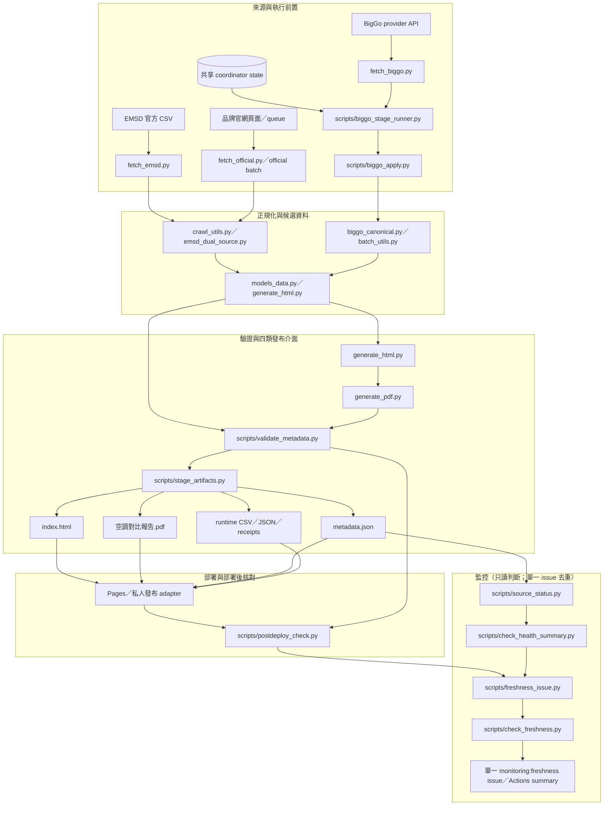
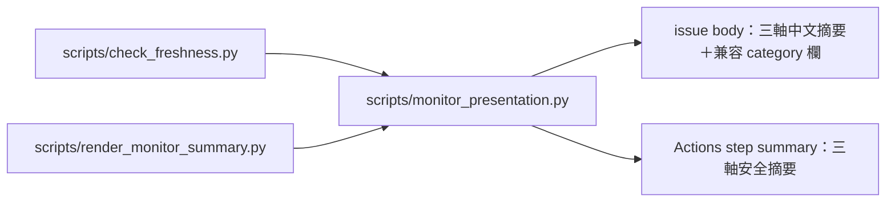

# 2026-10-18 資料流、發布與監控（Stage 0，append-only 新文件）

狀態：**靜態盤點，未部署**。圖只表示 repo 內可觀察的入口／引用；coordinator 的遠端動態、provider 實際可用性及私人部署接線不在圖中冒充已證實。

## 邊界說明

- **EMSD／品牌／BigGo** 是不同來源；「來源成功」不等於「價格查詢成功」，也不等於「已部署」。
- BigGo 的 coordinator、lease、cooldown、budget 是執行前置；圖中不表示本輪有 lease、provider 呼叫或新價格。
- `metadata.json` 的 `sourceStatus` 記錄取得／套用事實；`lastAcquiredAt` 不可由部署時間、封包時間或今日時間補出。
- 發布是四類介面（HTML、PDF、metadata、runtime 資料／收據），不是任意額外私人檔；公開與私人 adapter 的具體位置不應出現在公開文件。
- 監控只讀取已產生的 metadata／postdeploy／health summary；monitor 不呼叫 provider，也不自行改價格或 coordinator。

## 本輪 Stage 0 證據

- 工具：`scripts/architecture_audit.py`（AST + 檔案 hash + YAML workflow；不 import 生產模塊）。
- 公開 repo 基準：`534d158e4e852066b8951de161ed75cd514a7359`；詳細 JSON／caller／test 清單見交付目錄的 `architecture-audit.json`。
- 本圖的邊界與「來源 pin」詳見同日期 `public-private.md`；風險見 `2026-10-18-reuse-risks.md`。

## Stage 1 追加：監控呈現模塊（此後才生效的候選）

Stage 0 圖保留當時的 `check_freshness → issue` 路徑；Stage 1 新增單一 pure 呈現模塊，兩條呼叫都經它，不再各自組分類文字：

`monitor_presentation.py` 只依賴標準庫及傳入 facts，不 import `check_freshness`；不可以由它決定 health gate、fingerprint、去重或 close。Stage 1 沒有改 evaluate 的 72h facts／threshold、fingerprint 輸入、issue 去重／恢復契約。

## 2026-10-18 reviewed current entry

舊圖保留歷史；最新實際四檔鏈、caller 表及 machine audit 入口見 `2026-10-18-reviewed-models.md`（同目錄）。
