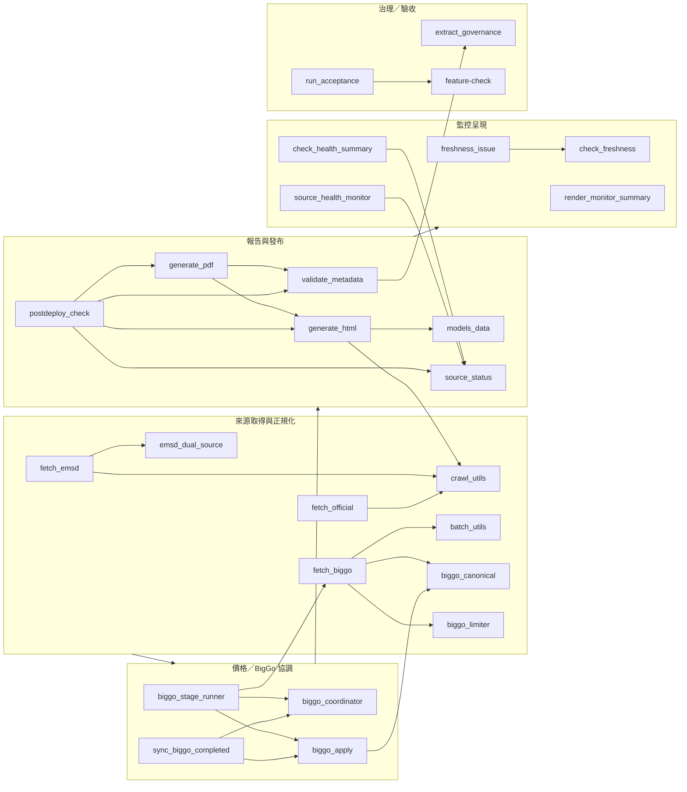

# 2026-10-18 Python 模塊依賴與責任（Stage 0）

此圖**分群**，只畫在 AST 可觀察到的靜態 import；不是執行時完整 call graph。測試以 `tests/` 為群，不逐條畫入。



## 責任與可觀察 caller

| 模塊 | Group | SHA256 前綴 | 靜態 caller 數 | 代表性 caller／入口 | 測試（靜態命中） |
|---|---|---|---:|---|---|
| `fetch_emsd.py` | acquisition | `fab48759be85…` | 2 | daily-update | `test_emsd_*` |
| `fetch_official.py` | acquisition | `49224c83b4bf…` | 1 | official batch | `test_official_batch_gate` 等 |
| `fetch_biggo.py` | acquisition | `1efb6dde47e2…` | 13 | stage runner、diagnostic、test probe | `test_biggo_*` |
| `scripts/biggo_stage_runner.py` | pricing/coordinator | `49a644fc8956…` | 3 | daily-update | `test_biggo_stage_runner` |
| `scripts/source_status.py` | monitoring | `de0d2b7d0662…` | 7 | check_health_summary、postdeploy_check | `test_source_status_*` |
| `scripts/check_freshness.py` | monitoring | `e07bb3a485df…` | 1 | freshness_issue | `test_freshness_monitor` |
| `scripts/freshness_issue.py` | monitoring | `d31dea34f62b…` | 1 | freshness-monitor workflow | `test_freshness_monitor` |
| `scripts/render_monitor_summary.py` | monitoring | `1afc107c7900…` | 0 static importer | freshness-monitor workflow step | `test_freshness_monitor` |
| `generate_html.py` | publication | `b946437682ae…` | 10 | daily-update、postdeploy | `test_core`／HTML suites |
| `generate_pdf.py` | publication | `66df6e0b49ab…` | 7 | daily-update、postdeploy | PDF suites |
| `scripts/postdeploy_check.py` | publication | `0a00034a5b3a…` | 2 | freshness-monitor、postdeploy workflow | `test_postdeploy_check` |
| `scripts/check_health_summary.py` | monitoring | `3afbb96db73c…` | 1 | freshness-monitor | `test_source_health_monitor` |

## 動態／未確認（不是已使用證據）

- `declaredDynamicOrUnknown`：`compare_emsd.py`、`fetch_og_specs.py`、`import_gemini_csv.py`、`verify_emsd.py`、`verify_links.py` 在此 AST 掃描沒有靜態 importer，亦不是 workflow 的 Python 入口；需要時才作獨立核對。
- workflow 中經 shell 呼叫的 script 由 YAML `run` 解析，不當作 Python import。
- `source_health_monitor.py` 沒有在此 repo 的 workflow 直接入口；私人部署工具 tree 的實際接線屬 **UNKNOWN**，不能宣稱 daily 已使用。
- 靜態 caller 數不等於 runtime 使用次數；tests 用 importlib 載入亦屬觀察到的測試引用，不是生產路徑。

## 可重現指令

```bash
python scripts/architecture_audit.py --repo .
python scripts/architecture_audit.py --repo . --peer-root <peer>
```

輸出預設 stdout；`--output`／`--output-dir` 只可新檔／新目錄（no-clobber），不執行或 import 任何生產模塊。

## Stage 1 追加：監控呈現模塊實際 caller／hash

| 模塊 | SHA256 | 實際靜態 caller | 測試 |
|---|---|---|---|
| `scripts/monitor_presentation.py` | `sha256:00dfaddf6ff6274be90c620e13349d131c8f160239100ca497bab753f39eaa65` | `scripts/check_freshness.py`、`scripts/render_monitor_summary.py` | `tests/test_monitor_presentation_20261018.py`、Root external contract |
| `scripts/check_freshness.py` | `sha256:c3256d9574c0902655854d79f805890292e9244a789b3282c588fd582468d532` | `scripts/freshness_issue.py` | `tests/test_freshness_monitor.py`、Root external contract |
| `scripts/render_monitor_summary.py` | `sha256:f8a9793feed98504a5ae1847950374f5ff1e05b910dea0ec640e1fec99e1e343` | freshness-monitor workflow（shell entry） | `tests/test_monitor_presentation_20261018.py` |

這三個 hash 是 Stage 1 實作快照；Stage 0 表格保留其當時基準，不覆寫。`monitor_presentation` 沒有反向 import monitor；B/C 軸的來源資料只接受已驗證 facts 或固定 allowlist 摘要。

### 2026-10-18 Stage 1 後續窄修 hash refresh

- `scripts/monitor_presentation.py`：`sha256:ae2a27086b6f2e454d6f07d0949e29010780bf9d160fd00491b1c7912f989f3a`
- `scripts/check_freshness.py`：`sha256:c3256d9574c0902655854d79f805890292e9244a789b3282c588fd582468d532`
- `tests/test_monitor_presentation_20261018.py`：`sha256:0045ec01f616d215fe8fb6332546633c29bb0bd582b983725f57542ad735e1db`
- 窄修只避免 healthy 狀態仍顯示來源失敗明細，並新增 report 寫入失敗先於 API 的測試；前表 Stage 1 hash 保留為歷史快照。

### 2026-10-18 Stage 1 最終 fingerprint-preserving hash

- `scripts/check_freshness.py`：`sha256:ae572c2fe59cf3b564f5aa8cfaeb52e6114568f09761f664e851eccb93524c97`（只改 issue body 呼叫；`combined_health`／`fingerprint`／classify 保持原輸入及原碼）
- `tests/test_monitor_presentation_20261018.py`：`sha256:e6a637a2aea1b207854a62be0259d13d094b78dfaac98184cf2fec33136fe7bf`
