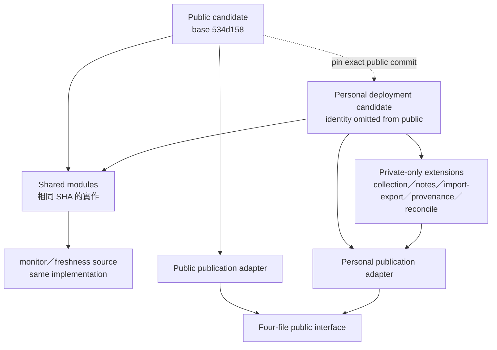

# 2026-10-18 公開／私人差異與來源 pin（Stage 0）

本文件只描述可公開的結構。私人 host、domain、私有 repo 路徑、token、個人帳戶與實際部署位置不在公開 repo 出現。

## 差異邊界

- 兩端共享的監控呈現實作以同一份 source 為準；環境差異留在 CLI／workflow adapter，不把私人功能刪掉以假裝「完全共用」。
- 私人收藏、組合、備註、import／export、provenance、動態 EMSD 報告及 reconcile 能力屬私人 extension；公開 repo 沒有這些功能不代表可刪。
- 本輪以兩端實際 AST／hash 比較，不把「同名」直接當「相同」，也不宣稱固定重用百分比。
- 同名 81 個檔案的歷史抽樣（62 相同、19 不同）只作背景；更完整的 Stage 0 掃描（包含測試及新檔）會因範圍不同而有不同計數，不能互相冒充。
- 公開 repo 只可 pin 公開 exact commit／hash；私人 repo 的詳細差異表留在私人 repo 或 repo 外交付，不複製到公開文件。

## Source pin 與發布

| 邊界 | 值／規則 |
|---|---|
| Public candidate base | `534d158e4e852066b8951de161ed75cd514a7359` |
| Private candidate | exact identity kept in private repo／delivery; not published here |
| Shared monitor presentation | 以兩端同一 source 實作；具體 exact commit 見交付 identity |
| Public → private pin | 只可使用公開 exact source commit／hash；不得把私人 host／repo 寫回公開 |
| 發布介面 | HTML、PDF、metadata、runtime 資料／收據；由各自 adapter 執行 |
| 未確認 | 私人 legacy deployment tree 的實際 daily 接線；不因檔名或舊 plan 當成已使用 |

## 本輪限制

- 沒有 push／deploy／Docker／正式環境操作；Root 才能做正式發布。
- 沒有把私人 dashboard／provider 事實寫成公開身份；任何 provider 或部署狀態仍以 Root 證據為準。

## 2026-10-18 reviewed current entry

舊圖保留歷史；最新實際四檔鏈、caller 表及 machine audit 入口見 `2026-10-18-reviewed-models.md`（同目錄）。
