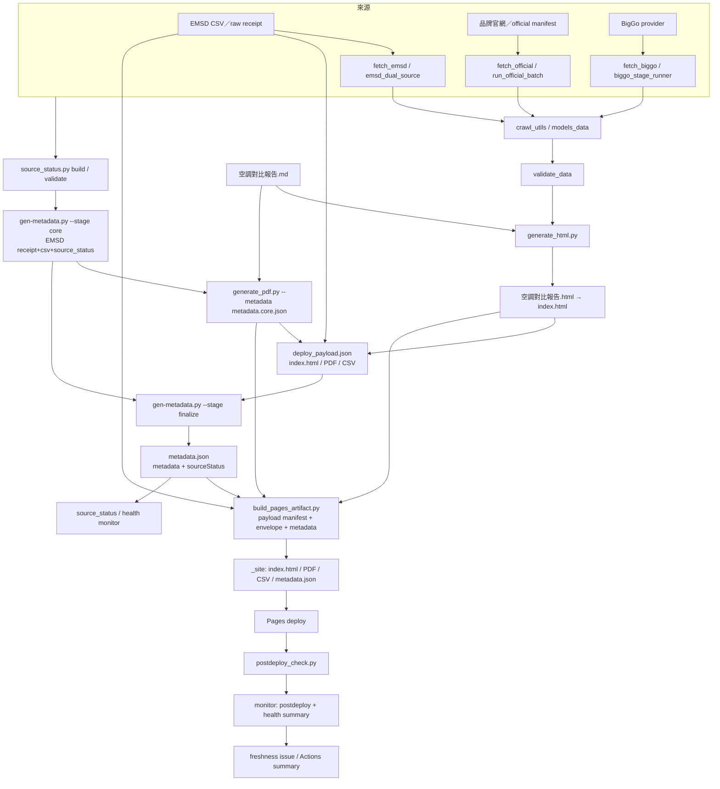
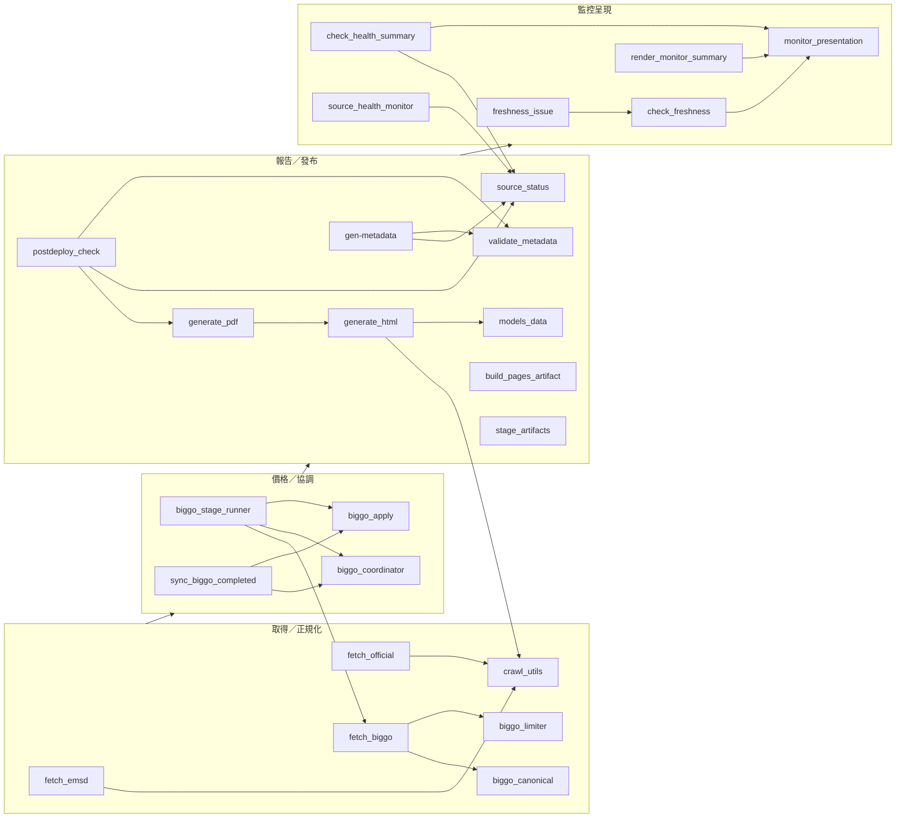
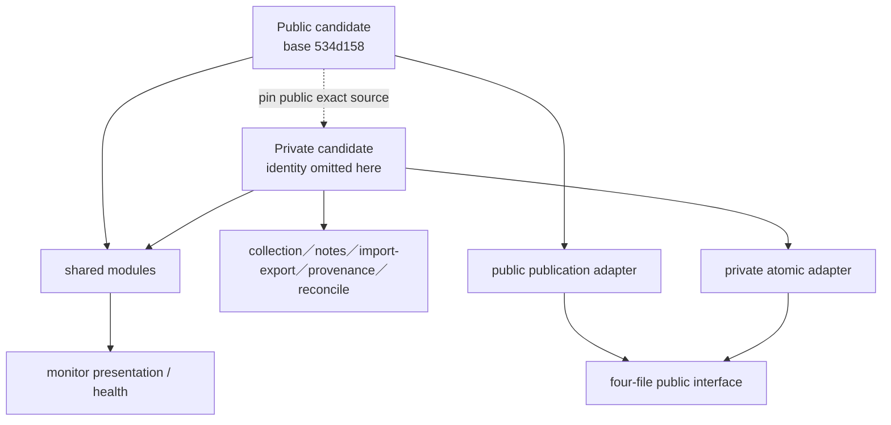

# 2026-10-18 Reviewed current entry: data flow, modules and public/private boundary

此文件是 2026-10-18 Stage 0 圖的**最新 reviewed 入口**；舊圖保留作歷史，不再用舊圖描述四檔發布。`scripts/architecture_audit.py` 的 machine output 是唯一可重算來源。

## A. 實際資料→候選→四檔發布／監控



實際 workflow 校正：

- 四檔公開介面是 **`index.html`、`空調對比報告.pdf`、`emsd_空調能源標籤.csv`、`metadata.json`**。
- `deploy_payload.json` 的 `files` **只有前三者**（HTML／PDF／CSV）；`metadata.json` 由 `deploy_envelope.json` 的 requiredFiles 額外包含，避免 metadata hash 自引用。
- `scripts/stage_artifacts.py` 是 daily workflow 的 **git commit/allowlist runtime/產物 staging**，不是 Pages 公開封裝器；不要把它畫成四檔 publisher。
- Pages 實際由 `scripts/build_pages_artifact.py` 讀 **deploy payload manifest + envelope + metadata** 精密封裝成 `_site`，再由 Pages workflow 部署。
- `generate_pdf.py --metadata metadata.core.json` 讀同一 run 的 metadata core 及 `空調對比報告.md`；不是讀 `index.html`。HTML 和 PDF 共享 report md／資料，但 PDF 的 metadata 來源是 core。
- `source_status.py build` 後 `validate`；其結果進入 metadata core／finalize 的 sourceStatus，必要 sidecar 只按 envelope 規則。
- `postdeploy_check.py` 用 final metadata、payload manifest、live HTML／PDF／CSV；source-health monitor 是獨立工作流（私人端已由 Root 證據確認 */15），不是 Pages packager。

## B. Python 模塊依賴（分群；只畫 observed static）



圖只表示 AST 能解析的 static edge；workflow shell entry 和 runtime dynamic 另列。`generate_pdf` 對 `generate_html` 的可觀察 import 不代表 PDF 讀 `index.html`；實際 CLI 用 `metadata.core.json` 及 report md。

## C. 公開／私人差異與 source pin



- 公開文件只可 pin 公開候選／shared source；私人 root、domain、repo、account、token 不在公開文件。
- 私人 collection、notes、import/export、provenance、動態 EMSD 報告及 reconcile 不得因 public 沒有而刪除。
- 私人 legacy deployment tools 的部分模塊 daily integration 仍未確認；詳細私人模塊名稱及接線只留私人 repo／交付，公開文件不列 peer 私有文件名單。
- 私人 health monitor（獨立 */15）已由 Root 正式證據確認；它與舊 legacy r24p 模塊的 daily integration 是兩件事，分開標記。

## D. 責任、production caller、static tests、source hash

下表以 **productionCallers** 為重用依據；`testsFor` 只是靜態關聯，不是測試已通過證據。Hash 是本 reviewed tool 觀察到的 source bytes；完整表在 `architecture_audit.py --repo` 輸出。

| 模塊 | SHA256（observed source） | production callers | workflow entry／static test |
|---|---|---|---|
| `scripts/monitor_presentation.py` | `73cf6fb9ce006cf4c02dab305627f7855f984db87f0a635307cfe62ace2ed1a4` | check_freshness、check_health_summary、freshness_issue、render_monitor_summary | 由 monitor workflow 經上列 caller；presentation test |
| `scripts/check_freshness.py` | `ae572c2fe59cf3b564f5aa8cfaeb52e6114568f09761f664e851eccb93524c97` | freshness_issue | freshness-monitor |
| `scripts/freshness_issue.py` | `118282592f6638daea91c634c46190f68ff20bdc0d45d32b7a7d502e21e6b826` | 無 static Python caller | freshness-monitor workflow entry |
| `scripts/check_health_summary.py` | `cc7b8b01ced56ec481739a9516051e64b1cdef43e72dd0eea974016178e00e0a` | 無 static Python caller | freshness-monitor workflow entry |
| `scripts/render_monitor_summary.py` | `3f310e0ebde02beba2562d98cd8e4653c93e59f6f49d5e88c187a65126a591db` | 無 static Python caller | freshness-monitor workflow entry |
| `scripts/architecture_audit.py` | `28f02c67dc94ad993e6edb628ab5effce318230e22bd06e041b1e95d9337a2d9` | 無 static Python caller | audit CLI（不應被生產 import） |
| `scripts/stage_artifacts.py` | `1f30ef6cfa3365f899990f2f15da5c215c8a48885d0fb3d94e89954956d23bab` | 無 | daily update commit allowlist；**不是 Pages packager** |
| `scripts/build_pages_artifact.py` | `588ee5b92408f61b1e88e86bf2881d40c02c34006dd07c5cda084c29236bf359` | 無 static Python caller | pages-deploy production／PR entry |
| `generate_html.py` | `b946437682ae671fb89fc38b8de2e0574d4e44a5537f3938ec40fa12ae9aecb7` | generate_pdf、postdeploy_check | daily `generate_html.py` |
| `generate_pdf.py` | `66df6e0b49abdd4965a4ae09e0a8e621157c87c4b44c05324e8b5e358b07294b` | postdeploy_check | daily PDF step |

## E. Reproducible audit and limits

Source hash observation commit: `109ad47df2b1e9eda5f63407c0c905098d2dc4fd`（其後 docs-only commit 不會改 source bytes；最終交付 identity 再列 exact heads）。

```bash
python scripts/architecture_audit.py --repo .
python scripts/architecture_audit.py --repo . --peer-root <peer>  # private review only
```

- 工具不 import／execute 生產 code；source／workflow 讀取前拒 symlink；`--output` 用 exclusive create；invalid Python／YAML 非零。
- `schedule` 讀取已處理 PyYAML 把 `on` 解析成 `True` 的情況。
- `productionCallers`、`testCallers`、`callers` 分開；`testsFor` 只 static association。
- `unresolvedStaticImports` 是 repo 內部無法解析的 import；`externalImports` 是 stdlib／第三方，不冒充內部依賴。
- 圖中的 workflow entry 是 shell 字面引用；dynamic import／runtime call 仍是 UNKNOWN，不能當已執行證據。

## F. BigGo pacing risk（不變，未修）

`fetch_biggo.py` 有 2.5s `BIGGO_MIN_PACE`，兩 worker 共用 `_wait_pace`；smoke `use_pace=False`；batch `_wait_pace` 在 `_get_access_token` 前，auth 後 search 可相連。需核對 daily smoke、daily batch、CLI smoke/batch、diagnostic `--execute`、test probe。HKT 10/18 00:32–00:39 私人自然 stage4 auth1/search149（UTC 10/17 完成）；14:04 GitHub probe auth1/search0→429；20:38／20:46 兩端 full 0/0 cooldown。會員頁未登入 redirect，API 收錄／日界線／帳戶匹配 unknown；provider quota 仍 UNKNOWN；auth 429 不可說成 product search endpoint 限流。本輪不改 fetch／limiter／runner／diag／delay。


## 2026-10-19 Root Stage1 收據反例更正（追加）
Root 在 review2 的 26 項既有反例通過後，額外重現：保留快照的 safeReason 可與 sourceStatusHash／BigGo hash 損壞同時出現，不能單憑原因碼聲稱快照已驗證。監控呈現改為「先前快照保留，核驗狀態見來源收據」，增加實際健康 producer→issue contract→呈現的損壞組合測試。原 review2 結果保留作歷史；此次不改 fingerprint、告警／恢復門禁、來源時間或任何供應商行為。正式發布仍須最終版本完整驗收。
