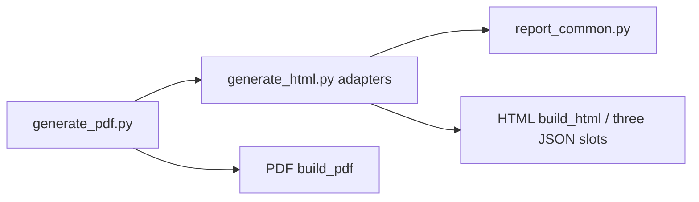

# 2026-10-19 Stage 2: shared report formatting and script-safe JSON

Status: isolated candidate, not merged/deployed. This document is appended after the accepted Stage0/Stage1 record; prior architecture files remain historical.

## Canonical pure module

`report_common.py` is the selected public-canonical shared source. It is pure: no files, clock, network, environment, `generate_html`, `models_data` or source fetcher imports.

API:

- `utc_to_hkt(value) -> str | None`: strict UTC Z only, optional fractional seconds, real calendar/clock validation, HKT minute output. Invalid types/calendar/offset/trailing data/overflow return `None`.
- `format_status(meta_dict, version, *, schedule_text=None) -> (line1, line2)`: acquisition and apply remain separate; invalid/missing times are unknown; deployment/package time never becomes acquisition; pending/degraded/blocked never become success. Environment schedule text is supplied by the adapter.
- `script_safe_json(obj) -> str`: `ensure_ascii=False`, compact separators, escapes `<`, `>`, `&`, U+2028/U+2029; round-trip preserves the value.

Runtime source observation: public coding commit `4e8571074b112588d73162bd84429cc79f4fdebc`; `report_common.py` SHA256 `92441476502f3eef911ad74ab2f44aea0617b8d62632b0ce06b8a5bbd1d070ca`.

## Actual callers／adapters

- `generate_html.format_status` is a thin compatibility wrapper; public `_hkt_text(str)` delegates to `utc_to_hkt`; private `_status_utc_hkt(str)`, `_parse_utc_strict(str)` and `_hkt_text(datetime)` remain adapters with their original signatures.
- `generate_pdf` keeps its `format_status` entry point and calls the HTML adapter, so PDF and HTML share the same Python date/source rules; private schedule text remains private-specific.
- `generate_html.script_safe_json` is a compatibility wrapper to the canonical helper. Public and private `build_html` route all three real data slots (`MODELS`, `emsd_models`/`EMSD_EXTRA`, `COMPARE_FIELDS`) through it.
- The bigint/date issue fixed here: public `_hkt_text` previously accepted fractional seconds by regex but `time.strptime` rejected them; the shared strict parser now accepts fractional UTC and validates impossible dates/times.
- Private EMSD facts/markdown/inject/report-md extensions remain private environment logic; only time parsing/formatting is delegated.

## Release integrity

`report_common.py` is now in `scripts/postdeploy_check.py` `REPRO_CODE_PATHS` and the runtime-module `__file__` check, so cached/foreign-tree report helpers fail closed before PDF rebuild. `scripts/verify_snapshot_rebuild.py` includes it in preserved source inputs. Candidate cloning includes tracked files; no generated HTML/PDF/metadata were changed by this module.

## JS runtime reference

The inline deploy-info HKT parser was minimally tightened to reject impossible calendar/clock values and fractional UTC remains supported; it still accepts only UTC Z. The JS and Python are semantically aligned but are not physically the same function. HTML/PDF Python callers use the same canonical formatter; no frontend source split was performed.

## Runtime difference versus private

Private keeps its private schedule wording and private EMSD facts/markdown/inject/report-md; public keeps GitHub Actions delay wording. The shared source is byte-identical on both ends; private pin receipt records the public canonical commit and both shared hashes.

## Verification boundary

Root 24 fixed contracts and Stage1 26 external contracts are run independently. Host browser/pypdf/CA gates are not claimed here; Root will run the approved `aircon-source-time-20261018:local` network-disabled full and browser checks on final clean commits. BigGo provider remains 0 calls; no coordinator/budget/grant/write, no price/official/queue/EMSД changes, no metadata regeneration.
