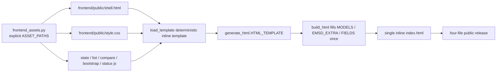

# 2026-10-19 Stage 3: controlled frontend source extraction

Status: isolated candidate, not merged/deployed. Prior Stage0/1/2 diagrams remain historical; this is the current frontend entry. No UI behavior redesign, no external CSS/JS requests, no data regeneration, no provider operation.

## Assembly and real caller path

- `frontend_assets.ASSET_PATHS` is the sole closed ordered tuple of production `.html`/`.css`/`.js` files under `frontend/`; there are no non-production examples there.
- `load_template()` reads only those repo-relative files, rejects symlink/missing sources, requires exactly one `__CSS__` and one `__SCRIPTS__` shell token, and never reads cwd/env/clock/network.
- `generate_html.HTML_TEMPLATE = frontend_assets.load_template()` at import; `build_html` remains the real caller. The assembled template is byte-identical to the Stage2 template (public hash `26ac06a5…`, private hash `d4de60fc…`) and still contains the three runtime JSON tokens.
- All frontend source files remain inline in one generated `index.html`; no `<script src=frontend/...>` or `<link href=frontend/...>`; no new HTTP assets.
- Assembly is completed before filling runtime data. `MODELS`/`EMSD_EXTRA`/`FIELDS` are not treated as assembly tokens.

## Public source inventory and callers

| Path | SHA256 |
|---|---|
| `frontend_assets.py` | `32ee9f6989e200abe2d4f6bd4e3a440e032516ff4aaabdd1440fb668658f4b97` |
| `frontend/public/shell.html` | `0800fd7a686313f3216013fdd11e9d23e77846852a9fc891694f02146f027cb1` |
| `frontend/public/style.css` | `a797bf13983da37ff7d0d84cea3762f70b7f84ed6d6f39a691147745ce801f4f` |
| `frontend/public/state.js` | `77e1a2cb5b0b27223b7b0b6b4124780c3811694f1eee98717a3e8bfded23e4eb` |
| `frontend/public/list.js` | `b68e1e2022f92c8d0c803be337356aff52763c0b9b8154935f85ea02d607d30e` |
| `frontend/public/compare.js` | `df9adcb30272a15b33d7e705f60895a21b8c5b7a0003fd2a82253583f5e411d0` |
| `frontend/public/bootstrap.js` | `7ec2cd579780faaf8de7992d893568708f9af1ccb5de3f7535268b80cba6b68c` |
| `frontend/public/status.js` | `b57256654add014678c54fa703a0b6b03115452c37f6e945f349e69db7e73a67` |

Real callers: `frontend_assets.py` ← `generate_html.py` (template import/build); each asset ← `frontend_assets.load_template`; `scripts/postdeploy_check.py` and `scripts/verify_snapshot_rebuild.py` consume the explicit source list for reproduction/preservation. These guard imports are static source-closure checks, not UI callers.

Private keeps its separate extension assets for collections/notes/groups/import-export/localStorage and EMSD source/status; public source is not copied into private and private functionality is not deleted. No same-hash count is claimed as runtime reuse percentage.

## Behavior preservation

- Public script function inventory from the Stage3 baseline remains 26; private remains 75; the assembled template hashes equal the baseline. No function is removed or renamed.
- Search, filters (brand/HP/type/energy/price/mount/status/selected-only), sorting, show-more, compare selection/highlight/copy/remove/clear, Escape/outside-click/focus/ARIA, scroll/navbar/tooltips, mobile/dark behavior remain in the original inline scope and order.
- Private favorites/notes/groups/localStorage/import-export/schema/size rejection/missing-model retention/storage denial/cookie preferences/provenance/analysis remain in private assets.
- HTML/PDF Python paths still use the Stage2 `report_common`; Python/JS status cases remain aligned but are not claimed to be physically shared.
- Stage2 script-safe JSON slots and strict date semantics are unchanged.

## Release dependency closure

Every asset path and `frontend_assets.py` is explicitly listed in `postdeploy_check.REPRO_CODE_PATHS` and `verify_snapshot_rebuild.REQUIRED_PRESERVED`. Drift/missing files fail before PDF build. Runtime `frontend_assets.__file__` is checked against the executing checkout, and `_pdf_repro_from_commit` re-verifies the assembled `HTML_TEMPLATE` equals a fresh `load_template()` before build, rejecting stale cached templates. Candidate copy, archive/Docker source and four-file publication guards therefore see the new sources.

## Time and historical correction

The Stage2 `IDENTITY.createdAt` (`2026-10-19T00:15:00Z`) and old private pin `observedAt` (`2026-10-19T00:00:00Z`) were future-labelled and are retained unchanged as historical bytes; they are not trusted UTC clock evidence. Root's actual UTC observation is recorded in the Stage2 acceptance append. New Stage3 receipt uses actual UTC (`2026-10-18T20:08:31Z`); Hong Kong date filenames do not imply UTC timestamps.

## Verification boundary

Host tests cannot run Chromium. Fixed contracts and host-targeted tests are recorded in the Stage3 delivery; Root must run the approved network-disabled Docker image for full 7 gates and Chromium. No Stage2 green count is reused as Stage3 acceptance.
